::: {.callout-note}
Working Papers Dewan Ekonomi Nasional (“DEN”) memuat temuan penelitian awal sebagai bahan diskusi dan kajian lebih lanjut. Analisis dan kesimpulan merupakan pandangan penulis dan tidak serta merta mencerminkan pandangan DEN, Ketua atau anggotanya, maupun Pemerintah Republik Indonesia. DEN tidak menelaah, memverifikasi, atau mengesahkan substansi naskah, dan publikasinya bukan merupakan persetujuan institusional. Pembaca menanggung risiko atas penggunaan materi ini, dan DEN maupun pegawainya tidak bertanggung jawab atas akibat penggunaannya.
:::

# Pendahuluan

Memasuki tahun 2025, ekonomi dunia dilanda ketidakpastian yang turut memberikan tekanan terhadap perekonomian Indonesia. *World Uncertainty Index* [@ahir2022wui] mencatatkan rekor tertinggi sepanjang sejarah pada rentang 2025--2026; dipicu oleh kebijakan tarif Amerika Serikat (AS) hingga konflik geopolitik di Timur Tengah yang menyebabkan gangguan distribusi bahan bakar melalui Selat Hormuz dan gangguan pasokan minyak dunia. Ketidakpastian ini memberikan tekanan pada perekonomian Indonesia terutama pada harga energi, nilai tukar, aliran modal, cadangan devisa, dan defisit neraca transaksi berjalan.

Sejumlah indikator ekonomi menggambarkan dampak dari ketidakpastian global. @fig-kurs menunjukkan perubahan nilai tukar sejumlah mata uang terhadap dolar AS secara *year-to-date*, di mana Rupiah mengalami pelemahan sebesar 6,4% (*year-to-date*, per 20 Agustus 2026), terdalam di antara mata uang yang dibandingkan, termasuk negara *peers* seperti Thailand, India, Filipina, Malaysia, dan Vietnam. @fig-cab memetakan posisi neraca transaksi berjalan terhadap perubahan nilai tukar *year-to-date* untuk negara-negara Asia, dan menunjukkan bahwa kondisi ekonomi yang mengalami defisit neraca transaksi berjalan yang semakin besar cenderung lebih berisiko mengalami pelemahan nilai tukar jika menghadapi _shock_. Indonesia berada pada kuadran ketiga, menggambarkan defisit neraca transaksi berjalan dan adanya tekanan besar dari sisi perubahan nilai tukar.

::: {layout="[[48,-4,48]]" layout-valign="bottom"}
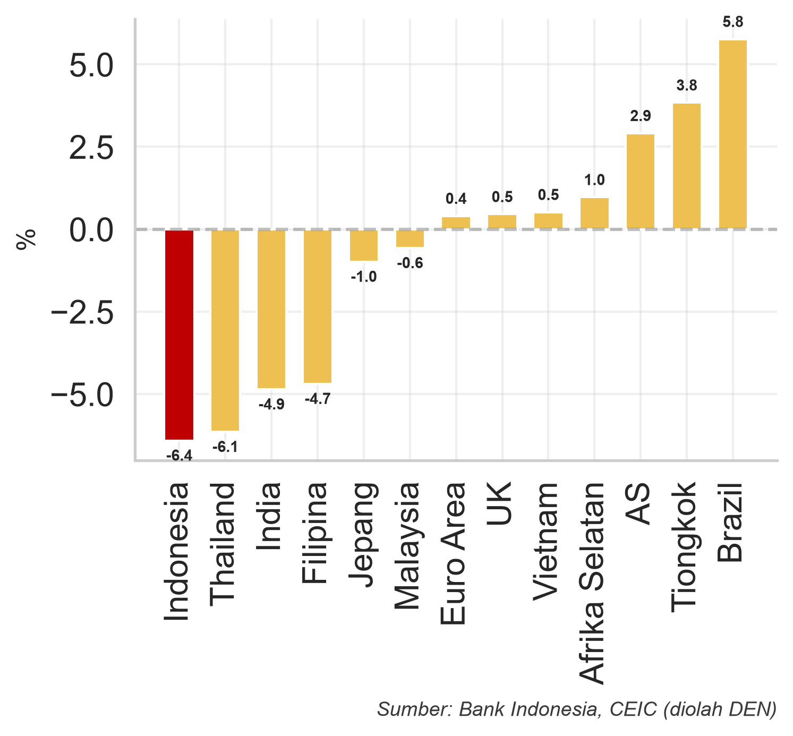{#fig-kurs}

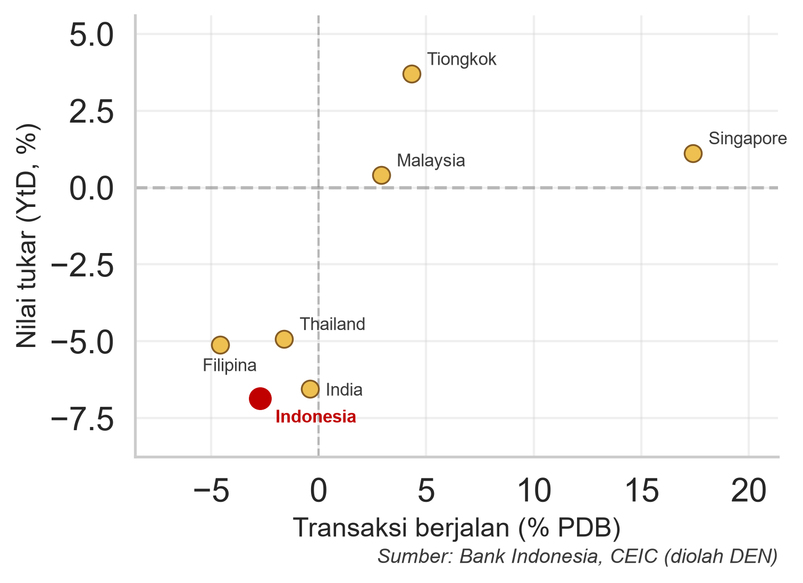{#fig-cab}
:::

Defisit transaksi berjalan yang persisten dapat meningkatkan kerentanan eksternal karena memperbesar kebutuhan pembiayaan dari aliran modal asing, dan apabila tidak mencukupi maka dapat menekan cadangan devisa serta nilai tukar. @fig-neraca menyajikan komponen neraca transaksi berjalan secara triwulanan dalam USD miliar. Gambar tersebut memberikan gambaran bahwa Indonesia memiliki akumulasi surplus pada neraca perdagangan barang dan pendapatan sekunder, namun menghadapi defisit yang persisten pada neraca jasa dan pendapatan primer.

Surplus neraca perdagangan barang selama ini menjadi penopang utama neraca transaksi berjalan. Namun, kembalinya neraca perdagangan barang ke posisi defisit pada Juni 2026, setelah mencatat surplus selama 72 bulan berturut-turut (@fig-barang, yang menampilkan neraca migas dan nonmigas bulanan dalam USD miliar beserta neraca perdagangan totalnya), mengindikasikan berkurangnya bantalan dari perdagangan barang terhadap keseimbangan eksternal. Kondisi ini memperkuat urgensi untuk melakukan diversifikasi sumber penerimaan devisa, termasuk melalui penguatan sektor jasa.

::: {layout="[[48,-4,48]]" layout-valign="bottom"}
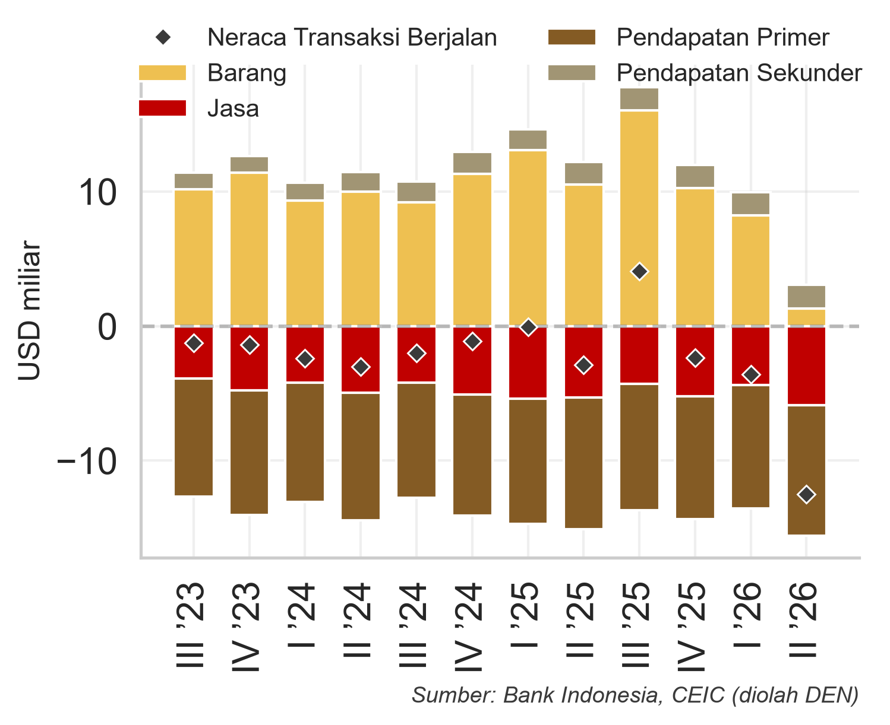{#fig-neraca}

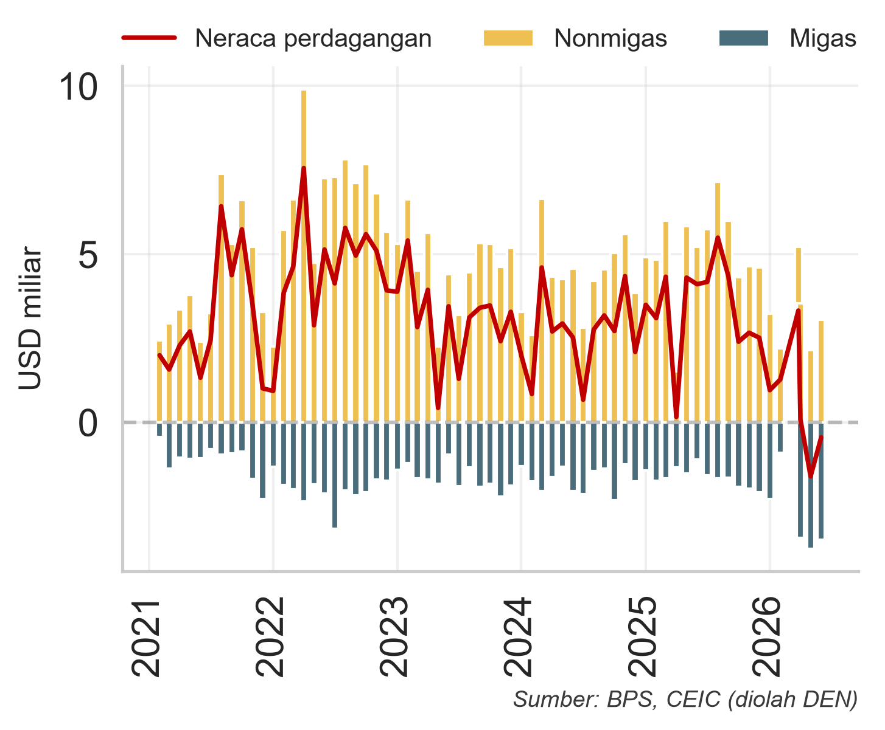{#fig-barang}
:::

Di tengah tekanan pada neraca perdagangan barang, jasa perjalanan, termasuk di dalamnya aktivitas pariwisata, menjadi salah satu komponen neraca jasa yang secara konsisten mencatat surplus. Kondisi ini menunjukkan masih terbukanya ruang untuk meningkatkan kontribusi sektor pariwisata sebagai sumber penerimaan devisa melalui kebijakan yang tepat dan terarah.

Indonesia meskipun dikenal memiliki berbagai destinasi wisata seperti Bali, jumlah kedatangan wisatawan mancanegara (wisman) relatif lebih rendah jika dibandingkan dengan negara ASEAN lainnya, seperti Thailand, Malaysia, Vietnam dan Singapura. @fig-wisman membandingkan jumlah kedatangan wisman lima negara ASEAN (sumbu datar) pada 2019 dan 2025 dalam juta orang (sumbu tegak). Pada 2025, jumlah kedatangan wisman ke Indonesia sebesar 15,3 juta orang [@bps2025wisman]. Sementara, jumlah wisman ke Thailand dua kali lipat sebanyak 32,9 juta orang, diikuti Malaysia sebanyak 26,6 juta orang, dan Vietnam sebanyak 21,2 juta orang. Hal ini menyebabkan penerimaan devisa yang ditopang aktivitas pariwisata Indonesia masih terbatas, hanya sebesar 1,2% terhadap PDB pada 2025, sedangkan Thailand sebesar 8,5% PDB, dan Malaysia 5,2% PDB (@fig-devisa, dengan satuan persen terhadap PDB pada sumbu tegak). Hal ini menggambarkan potensi penerimaan devisa dari sektor pariwisata Indonesia belum sepenuhnya dioptimalkan.

::: {layout="[[48,-4,48]]" layout-valign="bottom"}
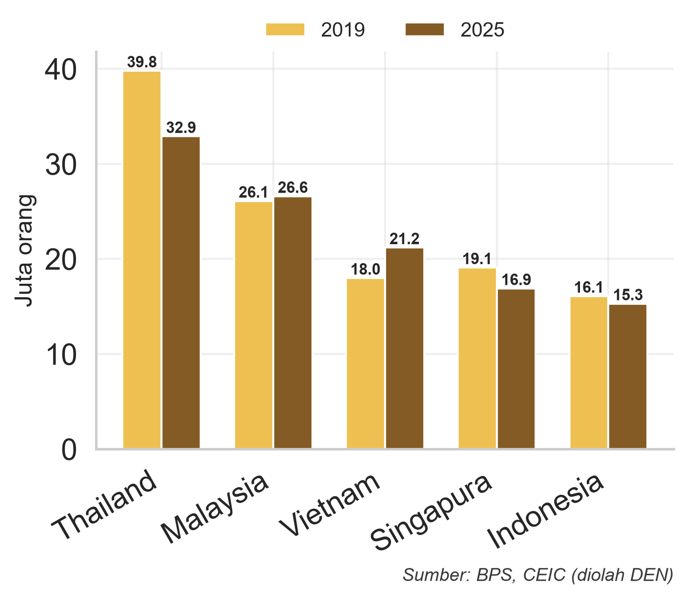{#fig-wisman}

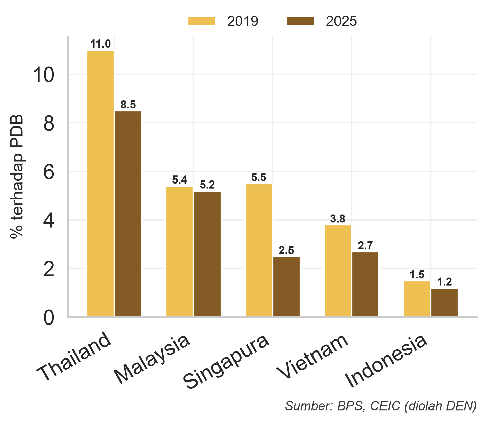{#fig-devisa}
:::

Dalam jangka menengah-panjang, peningkatan kunjungan wisatawan perlu ditopang oleh perbaikan fundamental pada sisi penawaran pariwisata (*supply-side*). Kebijakan perlu diarahkan pada peningkatan konektivitas domestik dan internasional, penguatan infrastruktur menuju dan di dalam destinasi wisata, peningkatan kualitas fasilitas dan amenitas, serta perbaikan standar pelayanan dan pengalaman wisatawan. Pengembangan destinasi juga perlu diikuti dengan peningkatan kualitas sumber daya manusia, promosi yang lebih terarah, serta pengembangan atraksi dan produk wisata yang mampu meningkatkan lama tinggal dan belanja wisatawan. Dengan pendekatan tersebut, kebijakan pariwisata tidak hanya diarahkan untuk meningkatkan jumlah kunjungan, tetapi juga memperbesar penerimaan devisa dan kontribusi sektor pariwisata terhadap perekonomian secara berkelanjutan.

Dalam jangka pendek, salah satu *quick win* yang dapat dipertimbangkan adalah perluasan Kebijakan Bebas Visa Kunjungan (BVK) secara bertahap dan selektif, terutama bagi negara yang memiliki potensi pasar wisatawan yang besar bagi Indonesia. Berbagai studi menunjukkan bahwa kemudahan visa dapat mendorong mobilitas dan kunjungan wisatawan internasional. @czaika2017visa, misalnya, menemukan bahwa penghapusan persyaratan visa dapat meningkatkan arus wisatawan sebesar 24,6%, dengan dampak yang relatif lebih besar pada negara berpendapatan rendah. Studi tersebut juga menunjukkan adanya efek pengalihan (*spatial diversion*), yaitu pembatasan visa pada suatu negara dapat mendorong wisatawan memilih destinasi alternatif yang memberikan kemudahan visa sebesar 0,4%. Sementara itu, @czaika2018global menunjukkan bahwa pola mobilitas global semakin dipengaruhi oleh multipolaritas regional dan kedekatan geografis, serta menemukan tingginya tingkat resiprositas kebijakan visa antarnegara, yakni sekitar 78--81%; temuan tersebut dibangun di atas basis data DEMIG VISA yang memetakan rezim visa bilateral antarnegara [@czaika2017demig]. Temuan-temuan tersebut memberikan dasar bagi penerapan BVK secara terukur dengan mempertimbangkan potensi tambahan wisatawan, penerimaan devisa, resiprositas, serta aspek keamanan dan keimigrasian.

@fig-negaravisa menyajikan jumlah negara penerima fasilitas bebas visa menurut negara pemberi fasilitas. Indonesia cenderung lebih restriktif dibandingkan dengan negara-negara lain dalam penerapan bebas visa. Indonesia hanya membebaskan visa terhadap 19 negara [@imigrasi2026bvk], lebih rendah dibandingkan negara-negara di ASEAN, seperti Singapura, Malaysia, Thailand dan Vietnam yang masing-masing menerapkan kebijakan BVK ke 162, 158, 60 dan 39 negara [@ica2026singapore; @jim2026malaysia; @tat2026visa; @immigration2026vietnam] (@fig-negaravisa). Sementara itu, Tiongkok mulai progresif dalam beberapa tahun terakhir menerapkan kebijakan BVK. Penerapan kebijakan tersebut dilakukan secara bertahap dengan kumulatif jumlah negara bebas visa yang terus meningkat, dari hanya 6 negara pada 2023, menjadi 50 negara pada 2026 [@chinabriefing2026visafree] (@fig-kumulatif). Strategi Tiongkok disini tidak terlepas dari rencana meningkatkan aktivitas ekonomi domestiknya, salah satunya melalui pariwisata sebagaimana direncanakan dalam rencana *15^th^ Five-Year Plan*.

::: {layout="[[48,-4,48]]" layout-valign="bottom"}
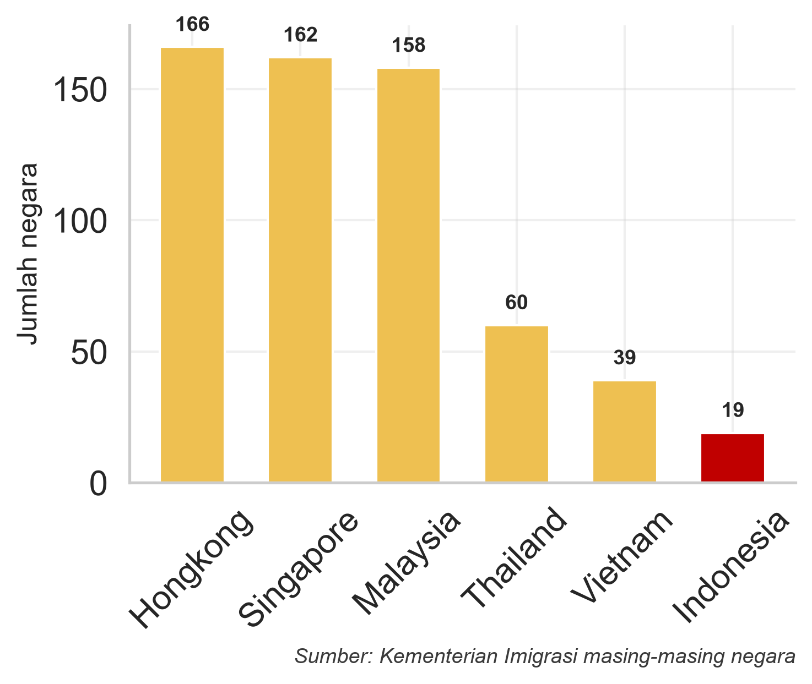{#fig-negaravisa}

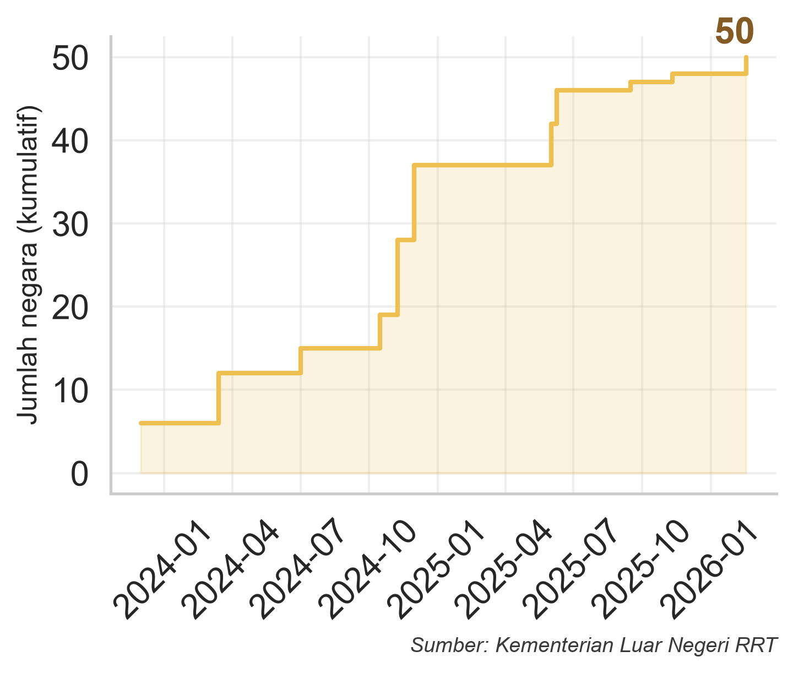{#fig-kumulatif}
:::

Di Indonesia, dinamika aliran wisman dari tahun ke tahun tidak terlepas dari berbagai perubahan rezim kebijakan visa. Dalam satu dekade terakhir, kebijakan visa Indonesia mengalami beberapa kali perubahan untuk meningkatkan mobilitas internasional dan mendorong aktivitas pariwisata. Sebelum tahun 2015, kebijakan masih didominasi oleh *Visa on Arrival* (VoA) dan pembebasan visa yang diberikan secara terbatas. Perubahan besar terjadi pada periode 2015--2016, ketika pemerintah memperluas fasilitas BVK secara ekstensif hingga mencakup 169 negara. Periode perluasan tersebut diikuti oleh peningkatan jumlah wisman dan ekspor jasa perjalanan. Ini menunjukkan adanya hubungan antara kemudahan mobilitas dan aktivitas ekonomi terkait pariwisata.

Kebijakan visa yang lebih restriktif dilakukan pada periode pandemi COVID-19. Fasilitas bebas visa dan sejumlah layanan visa dihentikan sementara sebagai bagian dari pembatasan mobilitas internasional. Seiring dengan pemulihan mobilitas global, Indonesia mulai mengadopsi pendekatan yang lebih selektif melalui *e-VoA*, *e-Visa*, dan berbagai bentuk fasilitasi visa sejak 2022. Perubahan tersebut menunjukkan pergeseran dari kebijakan pembebasan visa yang bersifat luas menuju rezim visa yang lebih terdiferensiasi dan selektif, dengan tingkat kemudahan yang disesuaikan menurut karakteristik negara asal dan tujuan kunjungan. Perkembangan ini menjadi konteks penting untuk mengevaluasi bagaimana kebijakan visa dapat memengaruhi mobilitas wisatawan sekaligus berinteraksi dengan aspek ekonomi dan keimigrasian.

Penerapan BVK berdampak positif terhadap peningkatan jumlah wisman, namun kebijakan ini perlu dilakukan dengan hati-hati mengingat ada dampak biaya dari kebijakan tersebut. Berdasarkan temuan @yudhistira2020heterogeneous, kebijakan BVK yang diterapkan di Indonesia hingga pembatasan sementara pada 2020 akibat COVID-19 berhasil meningkatkan jumlah kunjungan wisman, terutama dari Eropa sebesar 7,3%, negara maju sebesar 5,9% dan Asia (di luar Asia Tenggara) sebesar 5,8%. Namun, peningkatan jumlah wisman juga berdampak pada peningkatan pelanggaran imigrasi. Studi @prihartini2021immigration menemukan peningkatan pelanggaran imigrasi sebesar 44,2%, terutama berasal dari warga negara Afrika dan Asia, negara dengan pendapatan rendah dan menengah ke bawah, dan negara berkembang. Dengan demikian, penerapan kembali BVK perlu dilakukan secara terukur, yaitu bagaimana meningkatkan kuantitas tanpa mengorbankan kualitas (@tbl-strategi).

+------------------------------------------------+--------------------------------------------+
| **Jangka Pendek**                              | **Jangka Panjang**                         |
+================================================+============================================+
| - Menarik lebih banyak wisman dari pasar       | Membutuhkan penguatan holistik, seperti:   |
|   terpilih                                     |                                            |
| - Memprioritaskan negara dengan *spending*     | - Perbaikan destinasi                      |
|   tinggi                                       | - Konektivitas                             |
| - Memperpanjang lama tinggal                   | - Produk dan atraksi wisata                |
| - Meningkatkan kunjungan ulang                 | - Dukungan infrastruktur yang memadai      |
| - Memperluas perjalanan di luar Bali           |                                            |
+------------------------------------------------+--------------------------------------------+

: Strategi Peningkatan Wisatawan Mancanegara Berkualitas {#tbl-strategi}

\sumber{Analisis DEN}

Sebagai *benchmark*, Malaysia, Singapura, Vietnam, dan Thailand menunjukkan pendekatan liberalisasi visa yang berbeda sesuai dengan tujuan dan profil risikonya. Malaysia memperluas fasilitas bebas visa hingga mencakup Tiongkok pada 2024, dengan mempertimbangkan besarnya potensi pasar wisatawan Tiongkok serta aspek resiprositas (@tbl-malaysia). Singapura juga menerapkan pembebasan visa 30 hari secara timbal balik dengan Tiongkok untuk mempercepat pemulihan mobilitas dan memperkuat hubungan bilateral (@tbl-singapura). Sementara itu, Vietnam memilih pendekatan melalui e-Visa yang lebih luas dan fleksibel, yang sejak Agustus 2023 tersedia bagi seluruh negara dengan masa tinggal hingga 90 hari dan *multiple entry* (@tbl-vietnam). Berbeda dengan ketiga negara tersebut, Thailand menunjukkan bahwa liberalisasi visa juga dapat dikoreksi ketika risiko keimigrasian meningkat. Setelah memperluas *visa exemption* menjadi 93 negara dengan masa tinggal 60 hari pada Juli 2024, Thailand memperketat kembali cakupan dan durasinya menjadi 60 negara dengan masa tinggal 30 hari, ditambah 2 negara dengan masa tinggal 15 hari. Kebijakan tersebut disetujui kabinet pada 19 Mei 2026 dan berlaku sejak 15 September 2026 (@tbl-thailand).

| | **2015--2019** | **2024--sekarang** |
|:---------|:-------------------------------------|:------------------------------|
| Negara | 155 negara (tidak termasuk China) | 158 negara (termasuk China) |
| Durasi | Maks. 30 hari | Maks. 30 hari |

: Kebijakan Visa di Malaysia {#tbl-malaysia}

`\sumber{`{=latex}Kementerian Imigrasi Malaysia [-@jim2026malaysia], diolah DEN`}`{=latex}

*Latar belakang kebijakan*: China dipilih karena merupakan pasar wisata terbesar dengan potensi ekonomi tinggi, dan respons kebijakan Tiongkok yang memberikan Warga Negara Malaysia bebas visa (15 hari; resiprokal).

| | **2015--2019** | **2024--sekarang** |
|:---------|:-------------------------------------|:------------------------------|
| Negara | 158 negara (tidak termasuk China) | 162 negara (termasuk China) |
| Durasi | Maks. 30 hari | Maks. 30 hari |

: Kebijakan Visa di Singapura {#tbl-singapura}

`\sumber{`{=latex}Immigration and Checkpoints Authority Singapura [-@ica2026singapore], diolah DEN`}`{=latex}

*Latar belakang kebijakan*: mempercepat pemulihan mobilitas pasca pandemi dan memperkuat hubungan bilateral Singapura--China melalui asas timbal balik (resiprokal).

| | **2015--Agu 2020** | **Mar 2022--Jul 2025** | **Agu 2025--kini** |
|:---------|:--------------------|:------------------------|:--------------------|
| Negara | 25 negara | 25 negara | 39 negara |
| Durasi | Maks. 15--90 hari | Maks. 15--90 hari | Maks. 45--90 hari |

: Kebijakan Visa di Vietnam {#tbl-vietnam}

`\sumber{`{=latex}Vietnam Immigration Department [-@immigration2026vietnam], diolah DEN`}`{=latex}

*Latar belakang kebijakan*: penutupan gerbang internasional pada periode COVID-19, kemudian meningkatkan daya saing pariwisata terhadap negara ASEAN dan mengejar target 50 juta wisman pada 2030.

| | **Feb 2017--Jul 2024** | **Jul 2024--14 Sep 2026** | **15 Sep 2026--kini** |
|:---------|:------------------------|:--------------------------|:-----------------------|
| Negara | 57 negara | 93 negara | 60 negara (30 hari); 2 negara (15 hari) |
| Durasi | Maks. 30 hari | Maks. 60 hari | Maks. 30 hari (15 hari untuk 2 negara) |

: Kebijakan Visa di Thailand {#tbl-thailand}

`\sumber{`{=latex}Immigration Bureau of Royal Thai Government [-@immigration2026thailand], Kementerian Luar Negeri Thailand [-@mfathailand2026visa], dan Tourism Authority of Thailand [-@tat2026visa], diolah DEN`}`{=latex}

*Latar belakang kebijakan*: meningkatnya penyalahgunaan visa seperti *overstay* dan risiko keamanan, yang mendorong pengetatan aturan *visa-free* dan penguatan sistem seleksi berbasis risiko. Kerangka baru menerapkan prinsip *one country, one entitlement*, yakni setiap negara hanya masuk ke salah satu kategori: bebas visa 30 hari, bebas visa 15 hari, atau *Visa on Arrival* [@kpmg2026thailand]. Kerangka tersebut diundangkan dalam *Royal Gazette* pada 31 Agustus 2026 dan berlaku mulai 15 September 2026 [@tat2026visa].

# Metodologi

## Penentuan Negara-Negara Kandidat yang Memperoleh BVK

Dalam menentukan negara yang akan mendapatkan BVK, pemilihan negara menggunakan data yang tersedia dari BPS melalui *Passenger Exit Survey* [@bps2025pes]. Dari data tersebut, terdapat 28 negara yang belum memperoleh BVK (di luar dari 19 negara yang memperoleh BVK menurut PermenImipas 10/2026). Data-data tersebut mencakup volume kunjungan, pengeluaran per kunjungan, dan durasi tinggal per kunjungan. Untuk sementara, negara-negara di kawasan Timur Tengah, kecuali Arab Saudi, tidak termasuk dalam kandidat pertimbangan penerimaan BVK pada iterasi model mengingat keterbatasan akses data. Populasi sebanyak 28 negara ini berasal dari enam klaster geografis, di antaranya Benua Eropa (15 negara), Amerika (2 negara), Asia Timur dan Selatan (7 negara), Timur Tengah (1 negara), Afrika Utara (1 negara), dan Oseania (2 negara).

## Kerangka Seleksi Negara

Dari data tersebut, kerangka seleksi disusun untuk menjawab tiga pertanyaan untuk menentukan kelayakan negara memperoleh BVK, yaitu: (i) apakah negara tersebut memiliki nilai dan keselarasan strategis dengan kepentingan nasional Indonesia; (ii) apakah kunjungan dari negara tersebut menghasilkan hasil ekonomi yang tinggi; dan (iii) apakah negara tersebut memiliki skala pasar yang cukup besar untuk memberikan dampak yang signifikan. Ketiga pertanyaan ini diterjemahkan menjadi tiga aspek utama, yaitu Aspek Nilai Strategis (bobot 40%), Aspek Dampak Ekonomi/Kualitas (bobot 30%), dan Aspek Skala Pasar/Kuantitas (bobot 30%). Kerangka dan penentuan bobot ini menegaskan bahwa penerapan BVK tidak semata-mata mengejar volume wisman, melainkan menempatkan kesesuaian nilai strategis dan kualitas wisman sebagai pertimbangan utama.

| **Aspek Utama** | **Bobot** | **Sub-Komponen** | **Bobot** |
|:----------------|:---------------:|:-----------------|:----------------------:|
| **Nilai Strategis** | **40%** | GNI per kapita | 6,67% |
| | | Resiprositas dan hubungan bilateral | 6,67% |
| | | Indeks nilai tukar terhadap Rupiah | 6,67% |
| | | Aksesibilitas / proksimitas geografis | 6,67% |
| | | Indeks *Rule of Law* | 6,67% |
| | | Kepatuhan visa (jumlah TAK) | 6,67% |
| **Dampak Ekonomi/Kualitas** | **30%** | Rata-rata belanja per kunjungan | 15% |
| | | Rata-rata *yield* per hari | 15% |
| **Skala Pasar/Kuantitas** | **30%** | *Outbound departure* (2019) | 15% |
| | | *Growth blend* (CAGR 10Y exc. Covid + YoY 2023--2025) | 15% |

: Struktur Bobot Kerangka Seleksi Negara Kandidat {#tbl-bobotseleksi tbl-colwidths="[22,14,44,20]"}

\sumber{Estimasi DEN}

### Aspek Nilai Strategis

Aspek nilai strategis diberikan bobot tertinggi karena mencakup pertimbangan yang bersifat *non-tradable*, di mana faktor-faktor yang tidak dapat digantikan oleh instrumen kebijakan konvensional dan berhubungan langsung dengan kepentingan strategis-diplomatik Indonesia. Aspek ini didekomposisi menjadi enam sub-komponen dengan pembobotan yang setara (masing-masing 6,67%). Pembagian setara ini dipilih karena keenam sub-komponen bersifat komplementer, di mana masing-masing sub-komponen menangkap dimensi risiko atau peluang yang tidak dapat disubstitusi oleh sub-komponen lain.

1. *Gross National Income* (GNI) per kapita berfungsi sebagai proksi untuk *outbound travel propensity*, menggunakan data GNI per kapita metode Atlas dari *World Development Indicators* Bank Dunia [@worldbank2025wdi]. Studi *World Tourism Organization* [-@wto2013tourism] menunjukkan bahwa peningkatan pendapatan nasional per kapita berkorelasi positif dengan kecenderungan penduduk suatu negara untuk melakukan perjalanan ke luar negeri. Sub-komponen ini juga menjadi filter tidak langsung terhadap profil risiko keimigrasian, di mana negara berpendapatan rendah dan menengah-bawah cenderung memiliki tingkat pelanggaran keimigrasian yang lebih tinggi, seperti *overstay* dan penyalahgunaan visa [@prihartini2021immigration].

2. Resiprositas dan hubungan kerja sama merupakan realisasi kebijakan asas timbal balik yang diamanatkan Pasal 43 ayat (2) Undang-Undang Nomor 6 Tahun 2011 tentang Keimigrasian, yang menetapkan bahwa asas resiprositas menjadi salah satu pertimbangan dalam pemberian fasilitas bebas visa. Selain itu, keberadaan perjanjian bilateral/regional aktif dengan negara kandidat seperti *Free Trade Agreement* (FTA), *Comprehensive Economic Partnership Agreement* (CEPA), atau MoU pariwisata mencerminkan kesiapan kerangka institusional untuk mendukung mobilitas dua arah dan memberikan justifikasi diplomatik yang lebih kuat. Resiprositas dan hubungan kerja sama memiliki nilai yang setara dalam penilaian seleksi negara.

3. Indeks nilai tukar terhadap Rupiah merupakan perbandingan mata uang negara kandidat terhadap mata uang Indonesia selama dua tahun terakhir (2024--2026). Hal ini sejalan dengan temuan *International Monetary Fund* [-@imf2022areaer] bahwa penguatan nilai tukar negara asal relatif terhadap negara tujuan meningkatkan daya beli riil wisman dan volume perjalanan ke destinasi tersebut. Dalam konteks kajian ini, sub-komponen tersebut digunakan untuk menangkap keunggulan daya beli (*purchasing power advantage*) yang dimiliki wisman dari negara dengan mata uang kuat ketika berbelanja di Indonesia.

4. Aksesibilitas atau proksimitas geografis dihitung dari jarak *great-circle* (formula Haversine) antara Jakarta sebagai titik acuan dengan ibu kota negara kandidat. @rossello2020gravity dalam kerangka *Gravity Model of Tourism* menunjukkan bahwa daya tarik wisata menurun secara sistematis seiring dengan peningkatan jarak, mengingat jarak yang lebih jauh berkorelasi dengan biaya perjalanan yang lebih tinggi, durasi penerbangan dan waktu tempuh yang lebih panjang.

5. Indeks *Rule of Law* diambil dari *Rule of Law Index* yang diterbitkan oleh *World Justice Project* [-@wjp2024rol], dengan cakupan 142 negara. Indikator ini menjadi proksi untuk profil risiko keimigrasian negara asal: semakin tinggi skor *rule of law*, semakin rendah probabilitas warganya melakukan pelanggaran keimigrasian di negara tujuan. Untuk negara di luar sampel WJP (Swiss dan Arab Saudi), digunakan proksi *percentile rank* dari *Worldwide Governance Indicators* Bank Dunia [-@worldbank2024wgi].

6. Kepatuhan visa merupakan indikator historis pelanggaran keimigrasian per negara asal, berdasarkan data Jumlah Tindakan Administratif Keimigrasian (TAK) dari Kementerian Imigrasi dan Pemasyarakatan [@kemenimipas2026tak]. Sub-komponen ini secara konseptual melengkapi *Rule of Law* yang menangkap risiko institusional negara asal secara umum, sedangkan kepatuhan visa menangkap perilaku aktual wisman negara tersebut di Indonesia. Pada iterasi model dalam kajian ini, sub-komponen tersebut diberi skor netral (50/100) untuk seluruh negara karena keterbatasan data berdasarkan kewarganegaraan.

### Aspek Dampak Ekonomi/Kualitas

Aspek Dampak Ekonomi/Kualitas merepresentasikan intensitas nilai ekonomi yang dihasilkan setiap kunjungan wisman. Menurut studi terkait stimulus ekonomi melalui fasilitas visa oleh *World Travel and Tourism Council* [-@wttc2013visa], komponen pengeluaran wisman merupakan variabel kunci dalam menilai efektivitas kebijakan fasilitasi visa. Aspek ini terdiri atas dua sub-komponen dengan bobot yang setara, yaitu rata-rata belanja per kunjungan dan belanja per hari (*yield* per hari).

1. Rata-rata belanja per kunjungan (USD) dihitung dari data rata-rata 2015--2025 dengan mengeluarkan periode pandemi COVID-19 (2020--2022). Pengecualian periode pandemi diperlukan untuk menghindari distorsi struktural yang muncul akibat pembatasan mobilitas dan perubahan komposisi wisman selama pandemi (dominasi *long-stay* dan *high spending resident*, serta wisman diplomatik). Metrik ini mengukur nilai per kunjungan yang berkontribusi langsung terhadap devisa pariwisata.

2. Rata-rata *yield* per hari (USD) dihitung sebagai rasio belanja per kunjungan terhadap rata-rata lama tinggal (*length of stay*). Metrik ini mengukur intensitas belanja harian, yang dapat menghindari bias dari negara-negara dengan tingkat lama tinggal yang tinggi. Sebagai ilustrasi, wisman dari negara berpendapatan rendah dengan pola *long-stay backpacker* dapat memiliki total belanja per kunjungan yang tinggi hanya karena akumulasi hari, meskipun *yield* harian mereka rendah. Sebaliknya, wisman premium dengan durasi kunjungan pendek namun belanja intensif akan tercermin lebih akurat pada metrik *yield* per hari.

### Aspek Skala Pasar/Kuantitas

Aspek Skala Pasar/Kuantitas menangkap potensi volume kunjungan wisman dari masing-masing negara kandidat. Pada dasarnya, sebuah negara dengan *yield* harian yang tinggi tetapi memiliki basis pasar sangat kecil akan menghasilkan dampak agregat yang terbatas. Sebaliknya, negara dengan basis pasar besar meskipun *yield* per wisman relatif moderat dapat menghasilkan dampak devisa yang substansial. Aspek ini terdiri atas dua sub-komponen dengan bobot yang setara yaitu *outbound departure* dan *growth blend rate*.

1. *Outbound departure* menggunakan data volume keberangkatan penduduk suatu negara ke luar negeri dari *Compendium of Tourism Statistics* UN Tourism [@untourism2024outbound], dengan definisi *overnight visitors/non-excursionist* (bukan kunjungan sehari-pergi). Menurut @rossello2020gravity, melalui literatur *Gravity Model of Tourism*, semakin besar volume warga suatu negara yang bepergian ke luar negeri, semakin besar pula pasar wisatawan potensial yang dapat ditangkap oleh Indonesia. Data pada 2019 dipilih sebagai tahun terakhir pra-pandemi yang mencerminkan permintaan struktural sebelum pembatasan mobilitas pada periode COVID-19.

2. *Growth blend rate* merupakan rata-rata tertimbang dari dua ukuran pertumbuhan kunjungan wisman ke Indonesia [@bps2025wisman], yaitu: (i) *Compound Annual Growth Rate* (CAGR) periode 2015--2025 dengan mengeluarkan 2020--2022, sebagai proksi pertumbuhan struktural; dan (ii) rata-rata pertumbuhan *year-on-year* (YoY) 2023--2025, sebagai proksi momentum pemulihan pasca-pandemi. Kombinasi kedua ukuran ini dirancang untuk menghindari bias yang muncul jika hanya menggunakan salah satu. Jika menggunakan CAGR saja, maka cenderung akan meredam momentum pertumbuhan terkini karena efek rata-rata jangka panjang. Sedangkan jika hanya menggunakan pertumbuhan YoY saja, maka akan lebih sensitif terhadap efek pasca-COVID yang memperbesar pertumbuhan pada periode awal pemulihan.

## Metodologi Pembobotan dan Normalisasi

Seluruh variabel sub-komponen perlu dinormalisasi ke skala 0--100 sebelum dilakukan pembobotan rata-rata tertimbang. Hal ini dikarenakan 10 sub-komponen tersebut memiliki satuan dan rentang yang bervariasi. Menurut *Organisation for Economic Co-operation and Development* [-@oecd2008handbook], dalam konstruksi indeks komposit lintas-negara, setiap indikator/parameter perlu dinormalisasi skalanya. Dua pendekatan normalisasi diterapkan, yaitu normalisasi relatif untuk variabel yang berbeda satuan agar dapat diperbandingkan antarnegara, dan normalisasi absolut untuk variabel yang memiliki ambang batas atau klasifikasi baku secara internasional.

### Normalisasi Relatif (*Min-Max Scaling*)

Normalisasi ini dilakukan untuk sub-komponen *outbound departure*, *growth blend*, belanja per kunjungan, *yield* belanja per hari, dan aksesibilitas, menggunakan formula pada @eq-minmax.

$$
n_{i,v} = \frac{x_{i,v} - \min(x_v)}{\max(x_v) - \min(x_v)} \times 100
$$ {#eq-minmax}

dengan $n_{i,v}$ sebagai skor ternormalisasi negara $i$ pada sub-komponen $v$, $x_{i,v}$ merupakan nilai riil sub-komponen negara tertentu, dan nilai $\min(x_v)$ serta $\max(x_v)$ diambil dari populasi 28 negara kandidat.

Namun, untuk variabel aksesibilitas, formula dibalik menjadi *reverse min-max* seperti pada @eq-revminmax karena jarak yang lebih pendek memberikan skor lebih tinggi.

$$
n_{i,v} = \frac{\max(d_v) - d_i}{\max(d_v) - \min(d_v)} \times 100
$$ {#eq-revminmax}

dengan $d_i$ sebagai jarak *great-circle* antara Jakarta dan ibu kota negara $i$.

Perlu dicatat bahwa skor dari normalisasi relatif bersifat kontingen terhadap komposisi populasi kandidat, di mana perubahan populasi akan menggeser nilai minimum dan maksimum sehingga skor semua negara ikut berubah. Hal ini konsisten dengan tujuan pengukuran pada sub-komponen kompetitif, yaitu menempatkan posisi relatif suatu negara di antara kandidat lain, bukan mengukur kinerja terhadap standar mutlak.

### Normalisasi Absolut (Berbasis *Threshold*)

Untuk variabel yang memiliki interpretasi kebijakan stabil dan tidak bergantung pada komposisi kandidat, skor ditetapkan berdasarkan ambang batas objektif. Pendekatan absolut ini berlaku untuk sub-komponen GNI per kapita, resiprositas dan hubungan kerja sama, indeks nilai tukar terhadap Rupiah, indeks *Rule of Law*, dan tingkat kepatuhan visa (jumlah TAK). Ambang batas untuk GNI per kapita serta resiprositas dan hubungan kerja sama disajikan pada @tbl-normalisasi, dengan ambang kelas pendapatan mengikuti klasifikasi Bank Dunia [@worldbank2025wdi].

| **Variabel dan Kategori** | **Deskripsi / Ambang** | **Skor Normalisasi** |
|:--------------------------|:-----------------------|:--------------------:|
| **GNI per kapita (USD, 2025) --- klasifikasi Bank Dunia** | | |
| *Low income* | < 1.145 | 25 |
| *Lower-middle income* | 1.145--4.515 | 50 |
| *Upper-middle income* | 4.516--14.005 | 75 |
| *High income* | > 14.005 | 100 |
| **Kebijakan visa negara kandidat untuk WNI** | | |
| Memerlukan visa | Belum ada fasilitasi | 0 |
| Fasilitasi parsial | e-Visa, ETA, atau bebas visa terbatas | 50 |
| Bebas visa penuh | Bebas visa reguler bagi WNI | 100 |
| **Status hubungan bilateral / perjanjian ekonomi** | | |
| Tidak ada perjanjian aktif | --- | 0 |
| Perjanjian parsial / berlangsung | Negosiasi FTA/CEPA, MoU sektoral | 50 |
| Ada perjanjian aktif | FTA/CEPA, IJEPA, IK-CEPA, dll. | 100 |

: Skema Normalisasi Absolut GNI per Kapita serta Resiprositas dan Hubungan Kerja Sama {#tbl-normalisasi tbl-colwidths="[40,38,22]"}

\sumber{Estimasi DEN}

Skor akhir sub-komponen resiprositas dihitung sebagai rata-rata dari dua sub-skor kategori tersebut (resiprositas dan hubungan kerja sama). Sebagai ilustrasi, sebuah negara yang mensyaratkan visa bagi WNI (skor 0) namun memiliki FTA aktif dengan Indonesia (skor 100) akan memperoleh skor akhir resiprositas sebesar 50. Kemudian, skor *Rule of Law* diambil langsung dari *percentile rank* (0--100) yang dipublikasikan WJP dan WGI tanpa perubahan tambahan.

Lalu, skor indeks nilai tukar terhadap Rupiah dihitung sebagai indeks kurs mata uang negara kandidat terhadap Rupiah dengan tahun basis 2024. Kurs bilateral diperoleh melalui data *domestic currency per US dollar* dari *International Financial Statistics* IMF [@imf2025ifs], yaitu dengan membagi kurs Rupiah terhadap dolar AS dengan kurs mata uang negara kandidat terhadap dolar AS, sebagaimana pada @eq-crossrate dan @eq-indeks.

$$
\text{LCU/IDR}_{i,t} = \frac{\text{IDR/USD}_{t}}{\text{LCU/USD}_{i,t}}
$$ {#eq-crossrate}

$$
\text{Indeks}_{i,2026} = \frac{\text{LCU/IDR}_{i,2026}}{\text{LCU/IDR}_{i,2024}} \times 100
$$ {#eq-indeks}

Perhitungan dilakukan dalam dua tahap. Pertama, kurs bilateral terhadap Rupiah diturunkan melalui kurs silang (*cross rate*), karena data yang tersedia hanya menyediakan kurs setiap mata uang terhadap dolar AS. $\text{LCU/IDR}_{i,t}$ menyatakan jumlah Rupiah per satu unit mata uang negara $i$ pada tahun $t$, diperoleh dengan membagi $\text{IDR/USD}_{t}$ terhadap *local currency unit* (LCU) per USD negara $i$ pada tahun $t$. Kedua, kurs tersebut diubah menjadi indeks dengan membagi nilai tahun 2026 terhadap nilai tahun 2024 dan mengalikannya dengan 100, sehingga seluruh negara kandidat berangkat dari titik yang sama (2024 = 100) dan pergerakannya dapat dibandingkan tanpa terpengaruh perbedaan denominasi antar mata uang.

Untuk sub-komponen tingkat kepatuhan visa digunakan metode normalisasi absolut. Namun, pada kajian ini seluruh negara diberi skor netral (50) karena data Tindakan Administratif Keimigrasian belum tersedia berdasarkan kewarganegaraan [@kemenimipas2026tak].

### Agregasi Skor Akhir

Skor akhir diperoleh melalui *weighted sum* mengikuti struktur bobot pada @tbl-bobotseleksi, sebagaimana dinyatakan pada @eq-skorakhir.

$$
SA_i = \sum_{v} w_v \, n_{i,v}
$$ {#eq-skorakhir}

dengan $SA_i$ sebagai skor akhir negara $i$, $w_v$ sebagai bobot sub-komponen $v$, dan $n_{i,v}$ sebagai skor sub-komponen yang sudah dinormalisasi. Skor akhir juga berada pada rentang 0--100 sehingga dapat dibandingkan langsung antarnegara untuk keperluan pemeringkatan awal. Negara-negara dengan skor tertinggi menjadi kandidat penerima fasilitas BVK yang nantinya akan disimulasikan kembali dampaknya terhadap devisa pariwisata, biaya PNBP dan keimigrasian, pemulihan fiskal melalui pajak, dan multiplikasi *economic output*.

## Desain Skenario dan Prioritisasi berdasarkan Dampak

Kerangka seleksi pada bagian sebelumnya menjawab pertanyaan negara mana yang layak dipertimbangkan untuk memperoleh fasilitas BVK. Mengingat penerapan kebijakan tersebut juga akan berdampak pada penerimaan fiskal (Penerimaan Negara Bukan Pajak/PNBP) serta dampak biaya terhadap pengawasan dan penindakan pelanggaran keimigrasian, maka diperlukan dua langkah lanjutan, yaitu (i) menetapkan urutan prioritas di antara negara-negara terpilih berdasarkan potensi dampak keseluruhan, dan (ii) menyusun skenario implementasi secara bertahap. Bagian ini akan menguraikan kerangka metodologis untuk kedua langkah tersebut.

### Kebijakan BVK Bertahap berbasis Blok IEU-CEPA

Implementasi kebijakan BVK terhadap 15 negara terpilih tidak perlu dilakukan secara serentak, melainkan dapat disusun dalam beberapa fase implementasi yang bertahap dan selektif. Kajian ini mengadopsi prinsip *phasing* yang memprioritaskan negara-negara anggota Uni Eropa pada fase awal, memanfaatkan momentum finalisasi IEU-CEPA. Pilihan ini bertumpu pada empat pertimbangan utama: (i) sinergi dengan kerja sama ekonomi yang sedang berjalan, sebagai sinyal komitmen Indonesia dalam memperkuat kemitraan ekonomi menjelang finalisasi IEU-CEPA; (ii) peluang memperoleh manfaat resiprokal, yaitu alternatif kemudahan *visa cascading* untuk WNI; (iii) homogenitas profil risiko, mengingat negara Uni Eropa memiliki karakter risiko yang relatif seragam dan rendah; dan (iv) koherensi diplomatik, dengan memperlakukan negara Uni Eropa sebagai satu kesatuan blok untuk menghindari persepsi diskriminatif antar negara anggota sekaligus menyederhanakan komunikasi kebijakan antar pemerintah.

Prinsip *phasing* ini diterapkan di atas hasil seleksi berbasis merit. Pendekatan bertahap tersebut tetap mengacu pada hasil seleksi negara berdasarkan kriteria yang telah ditetapkan. Karena itu, Skenario 1 dan 2 difokuskan pada negara-negara Uni Eropa, sedangkan negara non-Eropa yang memiliki potensi dampak ekonomi besar dimasukkan dalam tahap perluasan melalui Skenario 3. Dalam Skenario 2, terdapat beberapa negara Uni Eropa yang sebenarnya berada di luar 15 besar hasil seleksi, yaitu Prancis (peringkat 16), Belgia (17), Belanda (18), Denmark (21), dan Finlandia (24). Masuknya negara-negara tersebut bukan merupakan penyimpangan dari kerangka seleksi, melainkan bagian dari desain kebijakan untuk menjaga kesatuan cakupan Uni Eropa sebagai satu blok serta memastikan kebijakan lebih konsisten dan mudah diterapkan dari sisi diplomatik.

### Konstruksi Skenario

Penetapan skenario mengutamakan adanya momentum finalisasi IEU-CEPA pada tahun ini sehingga disusun tiga skenario implementasi bertahap sebagaimana diringkas pada @tbl-skenario.

| **Skenario** | **Aturan Konstruksi** | **Jumlah Negara** |
|:-------------|:----------------------|:-----------------:|
| Skenario 1 (Negara EU) | Anggota Uni Eropa (IEU-CEPA) dan *Schengen Area* yang lolos seleksi 15 besar dengan skor prioritisasi tertinggi | 5 |
| Skenario 2 (Negara EU) | Skenario 1 diperluas dengan tambahan negara anggota Uni Eropa dan *Schengen Area* berikutnya | 10 |
| Skenario 3 (Negara EU + negara dampak tinggi) | Skenario 2 ditambah 5 negara non-Uni Eropa berdampak tertinggi, dipilih berdasarkan skor prioritisasi | 15 |

: Tiga Skenario Implementasi Negara Penerima Benefit BVK {#tbl-skenario tbl-colwidths="[26,58,16]"}

\sumber{Estimasi DEN}

### Kerangka Prioritisasi Berbasis Dampak Ekonomi

Untuk menentukan urutan prioritas di antara negara-negara terpilih, sekaligus mengidentifikasi negara non-Eropa dengan potensi dampak terbesar untuk tambahan negara pada Skenario 3, kajian ini menggunakan kerangka prioritisasi yang berbeda dari kerangka seleksi awal. Kerangka seleksi awal digunakan untuk menilai kelayakan strategis suatu negara untuk memperoleh fasilitas BVK dan menghasilkan 15 negara terpilih. Sementara itu, kerangka prioritisasi digunakan untuk menentukan urutan negara berdasarkan besarnya potensi dampak fiskal dan ekonomi bersih pada tahun pertama implementasi BVK. Penilaian prioritas dilakukan terhadap 15 negara terpilih dengan menggunakan lima faktor sebagaimana disajikan pada @tbl-bobotprioritas.

| **Faktor Penilaian** | **Bobot (%)** | **Sub-Komponen** |
|:---------------------|:-------------:|:-----------------|
| Tingkat pengembalian pajak | 15 | Rasio tambahan penerimaan pajak (PPN + PBJT) terhadap total biaya PNBP dan keimigrasian (mengukur efisiensi fiskal per rupiah biaya) |
| *Yield* belanja per hari | 30 | Belanja harian wisman rata-rata 2015--2025 di luar periode COVID-19 (2020--2022), yang mengukur intensitas nilai ekonomi setiap kunjungan |
| Skala ekonomi | 20 | Total nilai tambah ekonomi/efek multiplikasi pada tahun pertama (*case* agresif) |
| *Growth momentum* | 5 | Indikator yang sama dengan *growth blend* (CAGR + YoY *growth*) |
| Efisiensi PNBP (*reverse*) | 30 | Semakin kecil PNBP visa yang dilepas, semakin tinggi skor (menangkap biaya peluang fiskal) |

: Struktur Bobot Kerangka Prioritisasi Berbasis Dampak Negara Terpilih {#tbl-bobotprioritas tbl-colwidths="[24,12,64]"}

\sumber{Estimasi DEN}

Dua faktor penilaian yang berbasis dampak, yaitu tingkat pengembalian pajak dan skala ekonomi, dihitung secara seragam untuk tahun pertama menggunakan *case* agresif (*uplift* 11%) dan pada basis dampak murni kebijakan BVK sebagaimana diuraikan pada @sec-organik. Penggunaan basis tersebut ditujukan agar manfaat yang diukur setara cakupannya dengan biaya PNBP visa dan biaya keimigrasian yang dibandingkan. Pemilihan *case* agresif sejalan dengan tujuan kerangka prioritisasi, yaitu mengukur besaran potensi dampak, sehingga pengukuran didasarkan pada batas atas rentang estimasi pada @tbl-uplift. Adapun komponen biaya keimigrasian yang bersifat tetap (biaya pemantauan dan penyelidikan) dibagi merata ke 15 negara karena tidak dapat diatribusikan kepada negara tertentu.

Sama seperti kerangka seleksi negara, lima komponen ini akan dinormalisasi secara relatif (*min-max*; kecuali efisiensi PNBP secara terbalik) terhadap 15 negara terpilih. Skor prioritas akhir juga akan menggunakan formula yang sama dengan kerangka seleksi awal, yaitu metode *weighted sum* dengan struktur pembobotan prioritas yang ada pada @tbl-bobotprioritas.

## Kerangka Simulasi Dampak Ekonomi dari 15 Kandidat Negara Terpilih

Berdasarkan daftar negara yang telah ditetapkan melalui kerangka seleksi awal dan penyusunan skenario, tahap selanjutnya adalah melakukan estimasi dampak ekonomi dan fiskal dari implementasi kebijakan BVK. Estimasi mencakup tiga tahapan utama, yaitu penetapan asumsi peningkatan kunjungan wisatawan (*uplift*) akibat kebijakan BVK, perhitungan manfaat ekonomi dan fiskal, serta perhitungan biaya kebijakan. Manfaat yang diperhitungkan meliputi tambahan devisa, nilai tambah ekonomi, dan penerimaan pajak. Sementara itu, komponen biaya mencakup potensi PNBP yang tidak lagi diterima akibat pemberian BVK serta tambahan biaya keimigrasian. Estimasi dampak dilakukan secara tahunan dengan 2026 sebagai tahun dasar (*base year*), menggunakan data kunjungan wisatawan tahun 2025 sebagai basis perhitungan [@bps2025wisman].

Seluruh estimasi pada sub-bab ini dihitung pada dua basis agar manfaat dan biaya tidak dibandingkan pada cakupan kunjungan yang berbeda, yaitu: (i) basis agregat, yang mencakup seluruh tambahan kunjungan pada tahun implementasi, yakni gabungan pertumbuhan organik/historis dan efek kebijakan (*uplift*); dan (ii) basis dampak murni kebijakan BVK, yang hanya mencakup tambahan kunjungan yang timbul karena kebijakan, sehingga setara dengan cakupan biaya konsekuensi kebijakan (PNBP visa yang dilepas dan tambahan biaya keimigrasian).

### Skenario Pertumbuhan Organik dan Dampak BVK {#sec-organik}

Pada dasarnya, jumlah wisman yang berkunjung ke Indonesia bertumbuh secara organik/historis tanpa adanya intervensi kebijakan BVK. Pertumbuhan organik menggunakan data *growth blend* (sub-komponen Skala Pasar pada kerangka seleksi negara), yaitu rata-rata dengan bobot setara (50:50) dari CAGR 10 tahun (tanpa periode COVID-19, yaitu 2020--2022) dan rata-rata pertumbuhan tahunan tiga tahun terakhir (2023--2025), sebagaimana pada @eq-organik.

$$
g_i = \frac{\text{CAGR}^{10Y}_{i} + \text{YoY}^{3Y}_{i}}{2}
$$ {#eq-organik}

dengan $g_i$ sebagai pertumbuhan organik negara $i$, $\text{CAGR}^{10Y}_{i}$ sebagai *compound annual growth rate* kunjungan selama 2015--2025 di luar 2020--2022, dan $\text{YoY}^{3Y}_{i}$ sebagai rata-rata pertumbuhan tahunan 2023--2025.

Dengan adanya intervensi kebijakan BVK, diharapkan adanya tambahan (*uplift*) kunjungan setiap tahunnya. Pada kajian ini, dampak kenaikan kunjungan ditentukan di awal melalui dua skenario dengan rentang estimasi mengacu studi @yudhistira2020heterogeneous. Untuk tujuan komunikasi kebijakan dan kemudahan pemahaman, kedua parameter dibulatkan dari estimasi aslinya, yaitu 8,1% menjadi 8% dan 10,6% menjadi 11%, mengingat keduanya digunakan sebagai batas bawah dan batas atas rentang simulasi. Adapun dua skenario pertumbuhan *uplift* kunjungan tersebut disajikan pada @tbl-uplift.

| **Skenario** | ***Uplift* (%)** | **Dasar Penetapan** |
|:-------------|:----------------:|:--------------------|
| *Case* moderat | 8 | Efek kumulatif satu tahun paska intervensi kebijakan BVK |
| *Case* agresif | 11 | Efek pada periode puncak (*peak season*) dan diasumsikan berlaku sepanjang tahun untuk kelengkapan simulasi dampak |

: Parameter Peningkatan Kunjungan Wisatawan (*Uplift*) Dampak Intervensi Kebijakan BVK {#tbl-uplift tbl-colwidths="[20,14,66]"}

\sumber{Estimasi DEN}

Studi @yudhistira2020heterogeneous menunjukkan bahwa dampak kebijakan terhadap peningkatan kunjungan wisatawan berbeda antar-kawasan, yaitu sebesar 7,3% untuk Eropa, 5,8% untuk Asia non-ASEAN, dan 5,9% untuk negara maju. Namun demikian, dalam simulasi ini digunakan parameter agregat yang sama untuk seluruh negara agar hasil antar-skenario tetap dapat dibandingkan secara konsisten.

Dengan pendekatan tersebut, definisikan $V_{i,2025}$ sebagai volume kunjungan wisman tahun 2025 dari negara $i$ untuk digunakan menghitung dua jenis volume kunjungan wisman yaitu:

$$
V^g_{i,2026}=V_{i,2025} \times (1 + g_i)
$$ {#eq-organikvolume}

adalah volume kunjungan wisman tahun 2026 yang tumbuh secara organik dengan kecepatan pertumbuhan $g_i$, dan

$$
\begin{aligned}
V^u_{i,2026} &= V_{i,2026} \times(1 + u) \\
V^u_{i,2026} &= V_{i,2025} \times (1 + g_i)(1 + u)
\end{aligned}
$$ {#eq-upliftvolume}

yang merupakan volume kunjungan wisman tahun 2026 yang tumbuh secara organik dan ditambah efek _uplift_ kebijakan BVK sebesar $u$ dengan $u \in {8,11}$ sesuai dengan asumsi skenario pada @tbl-uplift. Dengan demikian, terdapat dua jenis pertumbuhan kunjungan wisman yang perlu diperhitungkan. Yang pertama merupakan pertumbuhan total 2026 (termasuk *uplift* BVK) dibandingkan 2025 yaitu:

Pertama, pertumbuhan agregat yang menggabungkan pertumbuhan organik tanpa intervensi kebijakan dengan tambahan (*uplift*) dari penerapan BVK, sebagaimana pada @eq-deltav. 

$$
\begin{aligned}
\Delta V^{\text{agregat}}_{i} &= V^{u}_{i,2026} - V_{i,2025} \\
\Delta V^{\text{agregat}}_{i} &= V_{i,2025} \times \big[ (1 + g_i)(1 + u) - 1 \big]
\end{aligned}
$$ {#eq-deltav}

Kedua, dihitung pertumbuhan yang berasal dari dampak murni kebijakan BVK, yaitu selisih antara volume kunjungan agregat dan volume kunjungan 2026 yang tetap terjadi melalui pertumbuhan organik:

$$
\begin{aligned}
\Delta V^{BVK}_{i,2026} &= V^{u}_{i,2026} - V^g_{i,2026} = V_{i,2025} \times u \, (1 + g_i)
\end{aligned}
$$ {#eq-deltavbvk}

Dengan kata lain, $\Delta V^{\text{agregat}}_{i}$ adalah tambahan kunjungan pada basis agregat dengan *uplift* BVK dan pertumbuhan organik dibandingkan 2025; dan $\Delta V^{\text{BVK}}_{i}$ sebagai tambahan kunjungan yang berasal dari dampak murni kebijakan BVK. Selisih keduanya, $\Delta V^{\text{historis}}_{i} = V^g_{i,2026} - V_{i,2025} = V_{i,2025} \times g_i$, merupakan tambahan kunjungan yang tetap terjadi tanpa kebijakan BVK.

### Devisa Pariwisata dan Nilai Tambah Ekonomi

Tambahan devisa pariwisata dihitung berdasarkan tambahan kunjungan wisman dan belanja rata-rata per kunjungan wisman. Sejalan dengan dua basis pertumbuhan pada @sec-organik, perhitungan dilakukan pada basis agregat melalui @eq-devisa dan pada basis dampak murni kebijakan BVK melalui @eq-devisabvk.

$$
\Delta \text{Devisa}^{\text{agregat}}_{i} = \Delta V^{\text{agregat}}_{i} \times S_i \times e
$$ {#eq-devisa}

$$
\Delta \text{Devisa}^{\text{BVK}}_{i} = \Delta V^{\text{BVK}}_{i} \times S_i \times e
$$ {#eq-devisabvk}

di mana $\Delta \text{Devisa}^{\text{agregat}}_{i}$ dan $\Delta \text{Devisa}^{\text{BVK}}_{i}$ masing-masing merupakan tambahan devisa dari pertumbuhan agregat dan dari dampak murni kebijakan BVK negara $i$, $S_i$ merupakan rata-rata belanja per kunjungan wisatawan dalam USD berdasarkan data rata-rata 2015--2025 di luar periode COVID-19 (2020--2022), dan $e$ merupakan nilai tukar Rupiah terhadap USD yang menggunakan rata-rata JISDOR Agustus 2026 [@bi2026jisdor]. Tambahan devisa tersebut mencerminkan peningkatan ekspor jasa perjalanan (*travel services*) dalam neraca pembayaran.

Selanjutnya, dampak terhadap perekonomian dihitung dengan mempertimbangkan efek pengganda dari belanja wisatawan. @worldbank2018itdp mencatat bahwa setiap US\$1 belanja pariwisata  (dalam hal wisman, $\Delta \text{Devisa}_i$) di Indonesia dapat menghasilkan sekitar US\$1,7 nilai tambah terhadap PDB melalui dampak langsung dan tidak langsung. Namun, estimasi tersebut masih bersifat bruto karena sebagian belanja wisatawan digunakan untuk barang dan jasa impor. Dengan mempertimbangkan *import leakage* yang diperkirakan sekitar 20%, kajian ini menggunakan pengganda sebesar 1,5 kali terhadap tambahan devisa pariwisata. Besaran tersebut lebih rendah dari estimasi @worldbank2018itdp sehingga memberikan asumsi yang lebih konservatif dalam memperkirakan tambahan nilai ekonomi dari implementasi kebijakan BVK.

### Estimasi Penerimaan Pajak Pusat (PPN) dan Pajak Daerah (PBJT)

Pengeluaran wisman per kunjungan di Indonesia memiliki 11 kategori sesuai dengan data dalam BPS *Passenger Exit Survey* (PES) setiap tahunnya. Setiap belanja yang dilakukan memiliki kategori belanja yang merupakan objek Pajak Pertambahan Nilai (PPN) yang menjadi penerimaan Pemerintah Pusat, sebagian merupakan objek Pajak Barang dan Jasa Tertentu (PBJT) yang menjadi penerimaan Pemerintah Daerah, dan sebagian lagi dibebaskan dari keduanya. Oleh sebab itu, kajian ini memetakan tangkapan pajak secara *bottom-up* dari kategori belanja aktual per negara pada tahun 2025, sebagaimana disajikan pada @tbl-pajak.

| **Kategori Belanja** | **Bobot PPN (Pusat)** | **Bobot PBJT (Daerah)** | **Dasar Pertimbangan** |
|:---------------------|:---------------:|:-----------------:|:-----------------------|
| Akomodasi | --- | 100% | Objek PBJT sektor perhotelan (UU 1/2022) |
| Makanan dan minuman | --- | 100% | Objek PBJT sektor restoran (UU 1/2022) |
| Penerbangan domestik | 100% | --- | Jasa angkutan udara niaga menjadi objek PPN (UU 7/2021) |
| Transportasi lokal | --- | --- | Dibebaskan dari PPN dan tidak termasuk objek PBJT |
| Sewa kendaraan | 100% | --- | Jasa sewa-menyewa kendaraan menjadi objek PPN (UU 7/2021) |
| Belanja dan suvenir | 100% | --- | Penyerahan barang kena pajak PPN (UU 7/2021) |
| Hiburan | --- | 100% | Objek PBJT sektor hiburan (UU 1/2022) |
| Kesehatan dan kecantikan | --- | 50% | Jasa medis dibebaskan PPN; jasa spa objek PBJT (tidak penuh) |
| Pendidikan / pelatihan | --- | --- | Jasa pendidikan dibebaskan dari kedua jenis pajak |
| Paket tur lokal | 10% | --- | Objek PPN dengan DPP nilai lain 10% dari nilai tagihan (PMK 71/PMK.03/2022) |
| Lainnya | 50% | 50% | Diasumsikan terbagi merata dari setiap transaksi pada kategori ini |

: Pemetaan Kategori Belanja Wisman terhadap PPN dan/atau PBJT {#tbl-pajak tbl-colwidths="[22,13,13,52]"}

\sumber{Analisis DEN}

Bobot pada @tbl-pajak menyatakan proporsi belanja pada setiap kategori yang menjadi Dasar Pengenaan Pajak (DPP). Sebagai ilustrasi, kategori kesehatan dan kecantikan diberi bobot 50% karena jasa medis dibebaskan dari PPN sementara jasa spa tetap dikenakan PBJT. Pada kategori paket tur lokal, DPP ditetapkan sebesar 10% dari nilai tagihan sehingga PPN jasa biro perjalanan tidak dikenakan atas seluruh nilai paket; ketentuan ini mencegah pajak berganda atas komponen paket yang telah dipajaki di tingkat penyedia jasa. Kategori lainnya diasumsikan terbagi merata karena keterbatasan data.

Estimasi penerimaan pajak dihitung melalui empat tahap. Pertama, menetapkan tarif efektif karena data PES BPS mencatat nilai transaksi yang sudah termasuk pajak, sehingga tarif nominal tidak dapat dikalikan langsung terhadap nilai belanja, melainkan dihitung dengan formula pada @eq-tarif.

$$
\tau^{j}_{\text{efektif}} = \frac{\tau^{j}_{\text{nominal}}}{1 + \tau^{j}_{\text{nominal}}}
$$ {#eq-tarif}

dengan $\tau^{j}_{\text{nominal}}$ sebagai tarif pajak jenis $j$ yang tercantum dalam undang-undang, $\tau^{j}_{\text{efektif}}$ sebagai tarif yang berlaku atas nilai transaksi termasuk pajak, dan $j$ sebagai jenis pajak, yaitu PPN atau PBJT. Dengan tarif nominal PPN 11% (UU 7/2021, PMK 131/2024) dan PBJT 10% (UU 1/2022), diperoleh tarif efektif masing-masing sebesar 9,91% dan 9,09%.

Kedua, menghitung nilai pajak yang ditangkap per kunjungan untuk setiap negara menggunakan formula pada @eq-pajakkunjungan.

$$
T^{j}_{i} = \left( \sum_{c} s_{i,c} \times \theta^{j}_{c} \right) \times \tau^{j}_{\text{efektif}}
$$ {#eq-pajakkunjungan}

dengan $T^{j}_{i}$ sebagai nilai pajak jenis $j$ per kunjungan dari negara $i$ dalam USD, $s_{i,c}$ sebagai nilai belanja negara $i$ pada kategori belanja $c$, dan $\theta^{j}_{c}$ sebagai bobot jenis pajak $j$ pada kategori belanja $c$ sebagaimana tercantum pada @tbl-pajak. Persamaan ini dihitung dua kali untuk setiap negara, yaitu dengan bobot PPN dan dengan bobot PBJT.

Ketiga, menghitung proporsi $T^{j}_{i}$ terhadap total belanja per kunjungan negara $i$, yang disebut tingkat tangkapan pajak, melalui @eq-kappa.

$$
\kappa^{j}_{i} = \frac{T^{j}_{i}}{S_i}
$$ {#eq-kappa}

dengan $S_i$ sebagai total belanja per kunjungan negara $i$. Rata-rata tingkat tangkapan pajak diestimasi sebesar 8,2% dari total belanja wisman, terdiri atas sekitar 2% pajak pusat (PPN) dan sekitar 6,2% pajak daerah (PBJT). Tingginya proporsi pajak daerah mengindikasikan bahwa belanja wisman di Indonesia masih terkonsentrasi pada kategori akomodasi serta makanan dan minuman. Besarannya sedikit berbeda antarnegara karena komposisi kategori belanja setiap negara berbeda, dan perbedaan inilah yang menjadi dasar faktor tingkat pengembalian pajak pada kerangka prioritisasi.

Keempat, menghitung tambahan penerimaan pajak dengan mengalikan tingkat tangkapan pajak terhadap tambahan devisa. Sejalan dengan dua basis estimasi, tambahan pajak pusat dan daerah dihitung pada basis agregat melalui @eq-pajak dan pada basis dampak murni kebijakan BVK melalui @eq-pajakbvk.

$$
\Delta \text{Pajak}^{j,\,\text{agregat}}_{i} = \Delta \text{Devisa}^{\text{agregat}}_{i} \times \kappa^{j}_{i}
$$ {#eq-pajak}

$$
\Delta \text{Pajak}^{j,\,\text{BVK}}_{i} = \Delta \text{Devisa}^{\text{BVK}}_{i} \times \kappa^{j}_{i}
$$ {#eq-pajakbvk}

dengan $\Delta \text{Devisa}$ masing-masing menggunakan nilai yang telah dihitung pada @eq-devisa dan @eq-devisabvk. Tambahan pajak pusat dan daerah pada setiap skenario diperoleh dengan menjumlahkan $\Delta \text{Pajak}$ seluruh negara dalam skenario tersebut.

### Biaya Visa (PNBP) yang Dilepas

Komponen biaya tidak langsung dari penerapan BVK adalah potensi PNBP visa yang tidak lagi diterima pemerintah dari wisman asal negara penerima BVK. Saat ini, wisman memiliki beberapa pilihan jenis visa kunjungan dengan tarif yang berbeda. Oleh karena itu, kajian ini tidak menggunakan satu tarif visa tertentu, melainkan menghitung rata-rata biaya visa secara tertimbang berdasarkan komposisi aktual penerbitan masing-masing jenis visa pada Triwulan I 2026 [@kemenimipas2026visa]. Pendekatan ini digunakan agar estimasi potensi kehilangan PNBP lebih mencerminkan pola penggunaan visa yang sebenarnya oleh wisman, sebagaimana dirinci pada @tbl-biayavisa.

| **Jenis Visa** | **Biaya (IDR)** | **Kontribusi terhadap Penerbitan Visa Tw-I/2026** | **Biaya Tertimbang** |
|:---------------|:---------------:|:------------------------------------------------:|:--------------------:|
| Visa B1 (VoA/e-VoA, 30 hari, *single entry*) | 500.000 | 90% | Rp450.000 |
| Visa C1 (e-Visa, 60 hari, *single entry*) | 1.000.000 | 9% | Rp90.000 |
| Visa D1 (e-Visa, 1 tahun, *multiple entry*) | 4.000.000 | 1% | Rp40.000 |
| **Biaya visa tertimbang untuk setiap wisman dari negara terpilih** | | | **Rp580.000** |

: Jenis dan Komposisi Biaya Visa Tertimbang {#tbl-biayavisa tbl-colwidths="[36,16,28,20]"}

\sumber{Estimasi DEN}

Dengan rata-rata tertimbang biaya visa sebesar Rp580.000, potensi PNBP yang tidak lagi diterima pemerintah akibat pemberian BVK dihitung dengan formula pada @eq-pnbp.

$$
\text{PNBP}^{\text{dilepas}}_{i} = V_{i,2026} \times \text{Rp}\,580.000 = V_{i,2025} \times \left( 1 + g_i \right) \times \text{Rp}\,580.000
$$ {#eq-pnbp}

di mana $V_{i,2026}$ merupakan volume kunjungan wisman tahun 2026 yang hanya tumbuh secara organik dan $V_{i,2025}$ merupakan volume kunjungan wisman tahun 2025 (*baseline*) dari negara $i$ sebagaimana diuraikan pada @sec-organik, sedangkan $g_i$ merupakan tingkat pertumbuhan organik/historis kunjungan wisatawan dari negara tersebut.

Perlu diperhatikan bahwa basis perhitungan PNBP yang dilepas berbeda dengan basis perhitungan manfaat kebijakan, seperti tambahan devisa, nilai tambah ekonomi, dan penerimaan pajak, yang dihitung pada kedua basis pertumbuhan. PNBP yang dilepas dihitung berdasarkan jumlah kunjungan yang diperkirakan tetap terjadi tanpa adanya kebijakan BVK, yaitu kunjungan tahun 2025 ditambah pertumbuhan organik masing-masing negara. Kunjungan tambahan yang timbul akibat kebijakan BVK tidak diperhitungkan karena tanpa intervensi tersebut peningkatan kunjungan diasumsikan tidak terjadi, sehingga tidak ada penerimaan visa yang hilang dari kelompok itu. Dengan demikian, komponen ini mencerminkan potensi penerimaan visa yang sebenarnya masih dapat diperoleh pemerintah apabila kebijakan BVK tidak diterapkan.

### Biaya Tambahan Keimigrasian

Menurut @prihartini2021immigration, penerapan kebijakan BVK berpotensi meningkatkan jumlah pelanggaran keimigrasian sehingga menimbulkan tambahan biaya bagi pemerintah. Dalam kajian ini, biaya keimigrasian terdiri atas komponen biaya tetap dan komponen biaya variabel.

$$
\text{Biaya Keimigrasian}^{b}_{i} = F+\text{Biaya Penanganan}^{b}_{i}
$$ {#eq-biayakeimigrasian}

dengan $b \in \{\text{agregat},\text{BVK}\}$ sesuai dua basis pertumbuhan kunjungan pada @sec-organik. $F$ merupakan komponen biaya tetap yang mencakup biaya pemantauan sebesar Rp6 miliar per tahun dan biaya penyelidikan sebesar Rp4 miliar per tahun. Biaya ini tidak bergantung pada jumlah kunjungan, tetapi hanya timbul apabila kebijakan BVK diterapkan, sehingga $F$ masuk ke kedua basis secara penuh. Sementara itu, komponen biaya variabel berupa biaya penanganan kasus keimigrasian, yang besarannya bergantung pada tambahan jumlah kasus akibat meningkatnya kunjungan wisman setelah penerapan BVK.

Estimasi biaya penanganan kasus dilakukan melalui tiga tahap. Pertama, dihitung tingkat pelanggaran dasar per 100.000 wisman berdasarkan rata-rata jumlah kasus keimigrasian dibandingkan dengan rata-rata kunjungan wisman selama periode 2023--2025, sebagaimana pada @eq-r0.

$$
r_0 = \frac{\bar{K}_{2023\text{--}2025}}{\bar{V}_{2023\text{--}2025}} \times 100.000
$$ {#eq-r0}

dengan $r_0$ sebagai tingkat pelanggaran dasar per 100.000 wisman, $\bar{K}$ sebagai rata-rata jumlah kasus keimigrasian, dan $\bar{V}$ sebagai rata-rata jumlah kunjungan wisman. Dengan rata-rata 8.472 kasus keimigrasian [@kemenimipas2026tak] dan 13,65 juta kunjungan wisman per tahun [@bps2025wisman] pada 2023--2025, diperoleh tingkat pelanggaran dasar sebesar 62,06 kasus per 100.000 wisman.

Kedua, tingkat pelanggaran dasar tersebut disesuaikan dengan estimasi @prihartini2021immigration, yang menunjukkan bahwa kebijakan BVK dapat meningkatkan tingkat pelanggaran keimigrasian sebesar 44,2%, sebagaimana pada @eq-rbvk. Dengan penyesuaian tersebut, tingkat pelanggaran naik menjadi sekitar 89,49 kasus per 100.000 wisman.

$$
r_{\text{BVK}} = r_0 \times (1 + 0{,}442)
$$ {#eq-rbvk}

dengan $r_{\text{BVK}}$ sebagai tingkat pelanggaran per 100.000 wisman setelah penerapan kebijakan BVK.

Ketiga, tingkat pelanggaran tersebut diterapkan terhadap tambahan kunjungan wisman, kemudian dikalikan dengan biaya penanganan sebesar Rp20 juta per kasus [@prihartini2021immigration]. Sejalan dengan dua basis pertumbuhan volume kunjungan pada @sec-organik, perhitungan dilakukan pada basis agregat melalui @eq-biayakasus dan pada basis dampak murni kebijakan BVK melalui @eq-biayakasusbvk.

$$
\text{Biaya Penanganan}^{\text{agregat}}_{i} = \text{Rp}\,20\ \text{juta} \times r_{\text{BVK}} \times \frac{\Delta V^{\text{agregat}}_{i}}{100.000}
$$ {#eq-biayakasus}

$$
\text{Biaya Penanganan}^{\text{BVK}}_{i} = \text{Rp}\,20\ \text{juta} \times r_{\text{BVK}} \times \frac{\Delta V^{\text{BVK}}_{i}}{100.000}
$$ {#eq-biayakasusbvk}

Kedua persamaan menggunakan tingkat pelanggaran yang sama, yaitu $r_{\text{BVK}}$, dan hanya dibedakan oleh basis volume tambahan kunjungan yang dikenakan, yaitu $\Delta V^{\text{agregat}}_{i}$ dan $\Delta V^{\text{BVK}}_{i}$ sebagaimana didefinisikan pada @sec-organik. Biaya pemantauan dan penyelidikan bersifat tetap setiap tahun sehingga dibagi merata ke seluruh negara dalam setiap skenario, sedangkan biaya penanganan kasus bersifat variabel dan berubah mengikuti tambahan kunjungan wisman pada masing-masing basis. Sebagai pembanding, kondisi tanpa kebijakan BVK dihitung dengan menerapkan tingkat pelanggaran dasar $r_0$ terhadap tambahan kunjungan yang tetap terjadi melalui pertumbuhan organik/historis, $\Delta V^{\text{historis}}_{i}$, tanpa penyesuaian 44,2% dan tanpa komponen biaya tetap $F$.

Perlu ditegaskan bahwa estimasi kenaikan pelanggaran sebesar 44,2% hanya diterapkan terhadap tambahan kunjungan yang terjadi akibat kebijakan BVK, bukan terhadap seluruh kunjungan wisman. Pendekatan ini didasarkan pada asumsi bahwa tambahan risiko keimigrasian berasal dari kunjungan baru yang muncul sebagai dampak kebijakan, sementara kunjungan yang tetap terjadi tanpa BVK tidak diperhitungkan sebagai tambahan risiko kebijakan.

### Nilai Net Fiskal Kebijakan BVK

Penerapan kebijakan BVK mengubah komposisi penerimaan negara dengan melepaskan PNBP visa yang bersifat pasti dan menggantikannya melalui tambahan penerimaan pajak pusat dan daerah dari belanja wisman. Namun, tambahan penerimaan pajak tersebut tidak dapat menutup biaya kebijakan karena PNBP dilepas atas seluruh basis kunjungan, sementara tambahan pajak hanya berasal dari belanja wisman pada tambahan kunjungan, dan pada saat yang sama kenaikan kunjungan menambah beban biaya keimigrasian. Indikator net fiskal diperlukan untuk memperkirakan margin manfaat ekonomi terhadap konsekuensi fiskal dari penerapan kebijakan BVK, sekaligus menjadi dasar untuk menilai kebutuhan penyesuaian anggaran bagi kementerian yang menjalankan fungsi keimigrasian.

Sejalan dengan dua basis pertumbuhan kunjungan, indikator ini dihitung pada basis agregat melalui @eq-netfiskal dan pada basis dampak murni kebijakan BVK melalui @eq-netfiskalbvk.

$$
\text{Net Fiskal}^{\text{agregat}}_{i} = \Delta \text{Pajak}^{\text{PPN},\,\text{agregat}}_{i} + \Delta \text{Pajak}^{\text{PBJT},\,\text{agregat}}_{i} - \text{PNBP}^{\text{dilepas}}_{i} - \text{Biaya Keimigrasian}^{\text{agregat}}_{i}
$$ {#eq-netfiskal}

$$
\text{Net Fiskal}^{\text{BVK}}_{i} = \Delta \text{Pajak}^{\text{PPN},\,\text{BVK}}_{i} + \Delta \text{Pajak}^{\text{PBJT},\,\text{BVK}}_{i} - \text{PNBP}^{\text{dilepas}}_{i} - \text{Biaya Keimigrasian}^{\text{BVK}}_{i}
$$ {#eq-netfiskalbvk}

dengan $\Delta \text{Pajak}$ sebagai tambahan penerimaan pajak pusat dan daerah (@eq-pajak untuk basis agregat dan @eq-pajakbvk untuk basis dampak murni kebijakan BVK), $\text{PNBP}^{\text{dilepas}}_{i}$ dari @eq-pnbp, serta biaya keimigrasian dari @eq-biayakeimigrasian, dengan biaya penanganan pada basis agregat dari @eq-biayakasus dan pada basis dampak murni kebijakan BVK dari @eq-biayakasusbvk. Nilai net fiskal yang negatif menunjukkan bahwa tambahan penerimaan pajak pada tahun pertama belum menutup biaya fiskal yang ditanggung negara. Karena PNBP yang dilepas selalu dibebankan atas seluruh basis kunjungan tanpa kebijakan, defisit fiskal pada basis dampak murni kebijakan BVK akan lebih besar daripada pada basis agregat.

# Hasil dan Pembahasan

Bab ini akan membahas hasil kerangka metodologi pada bab sebelumnya dalam tiga tahap yang berurutan, yaitu hasil kerangka seleksi 15 negara dari 28 negara kandidat, pemeringkatan lanjutan atas 15 negara terpilih berdasarkan potensi dampak fiskal-ekonomi dan aspek lainnya, serta simulasi dampak untuk tiga skenario implementasi secara bertahap.

## Hasil Kerangka Seleksi 15 Negara Terpilih

Hasil dari perhitungan kerangka seleksi dari 28 negara kandidat menghasilkan skor akhir pada rentang 42,08--64,98. Dari estimasi menggunakan kerangka tersebut, diperoleh 15 negara terpilih yang berpotensi tinggi mendapatkan fasilitas BVK (@tbl-hasilseleksi).

| **No** | **Negara** | **Kawasan** | **Skor Akhir Seleksi** |
|:------:|:-----------|:------------|:----------------------:|
| 1 | Amerika Serikat | Amerika Utara | 64,98 |
| 2 | Inggris | Eropa (non-Schengen) | 64,17 |
| 3 | Arab Saudi | Timur Tengah | 58,94 |
| 4 | Austria | Eropa (UE/Schengen) | 58,78 |
| 5 | Spanyol | Eropa (UE/Schengen) | 57,66 |
| 6 | Italia | Eropa (UE/Schengen) | 57,32 |
| 7 | Jerman | Eropa (UE/Schengen) | 55,58 |
| 8 | Selandia Baru | Oseania | 55,55 |
| 9 | Swiss | Eropa (Schengen non-UE) | 55,38 |
| 10 | Australia | Oseania | 55,29 |
| 11 | Korea Selatan | Asia Timur | 55,26 |
| 12 | Jepang | Asia Timur | 55,24 |
| 13 | Norwegia | Eropa (Schengen non-UE) | 53,01 |
| 14 | Portugal | Eropa (UE/Schengen) | 52,64 |
| 15 | Tiongkok | Asia Timur | 51,79 |

: Hasil Perhitungan Kerangka Seleksi {#tbl-hasilseleksi tbl-colwidths="[10,30,36,24]"}

\sumber{Estimasi DEN}

Berdasarkan hasil seleksi, delapan dari 15 negara terpilih berasal dari kawasan Eropa. Komposisi ini terutama dipengaruhi oleh struktur pembobotan yang menempatkan Aspek Nilai Strategis sebagai komponen terbesar, dengan bobot 40%. Di dalam aspek tersebut terdapat indikator GNI per kapita dan *rule of law*, yang cenderung memberikan skor tinggi bagi negara-negara Eropa Barat.

Meskipun demikian, hasil seleksi tidak hanya terkonsentrasi pada negara-negara Eropa. Tujuh negara non-Eropa juga masuk dalam 15 besar, yaitu Amerika Serikat (peringkat 1), Arab Saudi (3), Selandia Baru (8), Australia (10), Korea Selatan (11), Jepang (12), dan Tiongkok (15). Hal ini menunjukkan bahwa kerangka seleksi tetap mampu menangkap nilai strategis, kualitas ekonomi, dan potensi pasar dari negara-negara di luar Eropa.

Tiongkok memiliki karakteristik yang berbeda dibandingkan negara terpilih lainnya. Sebagai satu-satunya negara berpendapatan menengah-atas dalam daftar, posisi Tiongkok terutama didukung oleh skala pasar yang sangat besar. Namun, peringkatnya tertahan oleh skor *yield* atau belanja per hari wisatawan yang rendah, serta indikator *rule of law* yang relatif lebih rendah dibandingkan negara-negara terpilih lainnya.

## Hasil Kerangka Prioritisasi berdasarkan Potensi Dampak

Seleksi pada tahap sebelumnya menjawab pertanyaan negara mana yang layak dipertimbangkan untuk mendapatkan fasilitas BVK. Namun, tahap prioritisasi ini menjawab pertanyaan lanjutan, yaitu negara mana yang dapat diutamakan memperoleh fasilitas BVK. Penilaian menggunakan lima faktor berbasis dampak fiskal-ekonomi tahun pertama, yang menggunakan skenario *case* agresif (*uplift* 11%), menghasilkan skor pada @tbl-hasilprioritas.

| **Peringkat** | **Negara** | **Kelas Pendapatan** | **Yield/hari (USD)** | **Skor Prioritisasi** |
|:-------------:|:-----------|:---------------------|:--------------------:|:---------------------:|
| 1 | **Inggris** | Berpendapatan tinggi | 162 | 73,6 |
| 2 | **Arab Saudi** | Berpendapatan tinggi | 158 | 72,9 |
| 3 | **Amerika Serikat** | Berpendapatan tinggi | 165 | 70,1 |
| 4 | **Spanyol** | Berpendapatan tinggi | 155 | 69,8 |
| 5 | **Italia** | Berpendapatan tinggi | 140 | 64,5 |
| 6 | Korea Selatan | Berpendapatan tinggi | 162 | 64,5 |
| 7 | Jepang | Berpendapatan tinggi | 169 | 64,0 |
| 8 | Austria | Berpendapatan tinggi | 168 | 63,1 |
| 9 | Portugal | Berpendapatan tinggi | 163 | 61,6 |
| 10 | Australia | Berpendapatan tinggi | 162 | 60,6 |
| 11 | Swiss | Berpendapatan tinggi | 131 | 56,2 |
| 12 | Selandia Baru | Berpendapatan tinggi | 114 | 53,5 |
| 13 | Jerman | Berpendapatan tinggi | 114 | 52,5 |
| 14 | Norwegia | Berpendapatan tinggi | 128 | 46,9 |
| 15 | Tiongkok | Menengah atas | 85 | 27,4 |

: Hasil Perhitungan Kerangka Prioritisasi {#tbl-hasilprioritas tbl-colwidths="[14,26,26,17,17]"}

\sumber{Estimasi DEN}

Hasil kerangka prioritisasi menunjukkan urutan yang berbeda dibandingkan dengan hasil seleksi awal. Dalam kerangka prioritisasi, Inggris, Arab Saudi, Amerika Serikat, Spanyol, dan Italia menempati lima peringkat teratas. Negara-negara tersebut memiliki kombinasi yang kuat antara tingkat belanja harian wisatawan yang tinggi, sekitar USD140--165, skala ekonomi yang besar, serta efisiensi fiskal yang relatif baik.

Sebaliknya, beberapa negara Eropa dengan peringkat tinggi dalam kerangka seleksi, seperti Austria dan Norwegia, turun ke peringkat bawah dalam kerangka prioritisasi (peringkat 11--15). Hal ini terutama disebabkan oleh basis kunjungan wisatawan yang relatif kecil, sehingga potensi tambahan manfaat ekonomi dan fiskal secara agregat juga lebih terbatas.

Perbedaan tersebut menunjukkan bahwa kelayakan strategis suatu negara dan besarnya potensi dampak fiskal-ekonomi merupakan dua dimensi yang berbeda. Dampak bersih kebijakan dapat terbatas setidaknya dalam dua kondisi. Pertama, basis pasar relatif kecil, sehingga tambahan kunjungan hanya menghasilkan manfaat ekonomi yang terbatas, seperti pada Austria dan Norwegia. Kedua, basis pasar sudah besar dan mapan, sehingga sebagian besar wisatawan diperkirakan tetap akan berkunjung meskipun tanpa fasilitas BVK. Dalam kondisi ini, potensi PNBP visa yang dilepas dapat relatif besar dibandingkan dengan tambahan kunjungan yang dihasilkan, seperti pada Australia.

Pertimbangan tersebut tercermin dalam komponen efisiensi PNBP yang memiliki bobot 30% dalam kerangka prioritisasi. Komponen ini digunakan untuk menilai sejauh mana potensi manfaat tambahan dari BVK sebanding dengan penerimaan visa yang harus dilepaskan pemerintah.

## Simulasi Dampak Ekonomi Tiga Skenario Implementasi

Tiga skenario mengikuti prinsip *phasing* yang dimulai dari negara-negara blok Uni Eropa termasuk *Schengen Area* untuk memanfaatkan momentum IEU-CEPA sebagaimana diuraikan pada Boks 1 (Resiprositas Sebagai Basis Kebijakan Bebas Visa Bagi Uni Eropa), kemudian diperluas ke pasar yang berdampak tinggi. Komposisi negara pada masing-masing skenario disajikan pada @tbl-komposisi.

| **Skenario** | **Komposisi Negara** | **Keterangan** |
|:-------------|:---------------------|:---------------|
| **Skenario 1** (Blok EU dan *Schengen Area*) | Spanyol, Italia, Jerman, Portugal, dan Austria | Peringkat berdasarkan hasil kerangka prioritisasi (hanya blok EU dan *Schengen Area*) |
| **Skenario 2** (Blok EU dan *Schengen Area*) | Skenario 1 ditambah Prancis, Belgia, Belanda, Denmark, Finlandia | Peringkat berdasarkan hasil kerangka seleksi di luar 15 negara |
| **Skenario 3** (Blok EU dan *Schengen Area* + negara berdampak tinggi) | Skenario 2 ditambah Amerika Serikat, Inggris, Arab Saudi, Korea Selatan, Jepang | Peringkat berdasarkan hasil kerangka prioritisasi |

: Komposisi Negara pada Tiga Skenario {#tbl-komposisi tbl-colwidths="[28,36,36]"}

\sumber{Estimasi DEN}

Masing-masing skenario dievaluasi pada tiga estimasi dampak, yaitu (a) pertumbuhan organik/historis tanpa kebijakan BVK, (b) pertumbuhan agregat yang menggabungkan pertumbuhan historis dan kebijakan BVK dengan *uplift* 8% (*case* moderat), dan (c) pertumbuhan agregat dengan *uplift* 11% (*case* agresif). Dampak murni kebijakan BVK disajikan sebagai rentang dari batas bawah (moderat, b--a) hingga batas atas (agresif, c--a), kecuali PNBP visa yang dilepas karena komponen tersebut sepenuhnya merupakan konsekuensi implementasi kebijakan. Hasil untuk ketiga skenario disajikan pada @tbl-dampak1, @tbl-dampak2, dan @tbl-dampak3.

| **Indikator (tahun pertama)** | **(a) Pertumbuhan organik/historis** | **(b) Agregat, *uplift* 8% (*case* moderat)** | **(c) Agregat, *uplift* 11% (*case* agresif)** | **Dampak murni BVK [(b--a) s.d. (c--a)]** |
|:------------------------------|:------------:|:------------:|:------------:|:------------:|
| Tambahan kunjungan wisman (ribu jiwa) | 54 | 110 | 132 | 56--77 |
| Tambahan devisa pariwisata (Rp triliun) | 1,8 | 3,7 | 4,4 | 1,9--2,6 |
| Nilai tambah ekonomi (Rp triliun) | 2,7 | 5,5 | 6,6 | 2,8--3,9 |
| Tambahan pajak pusat dan daerah (Rp triliun) | 0,14 | 0,29 | 0,35 | 0,15--0,21 |
| PNBP visa yang dilepas (Rp triliun) | --- | 0,41 | 0,41 | 0,41 |
| Biaya keimigrasian (Rp miliar) | 0,7 | 12,0 | 12,4 | 11,0--11,4 |
| Nilai net fiskal kebijakan (Rp triliun) | 0,14 | −0,13 | −0,07 | −0,27 s.d. −0,21 |

: Estimasi Dampak Ekonomi Tahun Pertama (Skenario 1) {#tbl-dampak1 tbl-colwidths="[28,16,18,18,20]"}

`\sumber{`{=latex}Estimasi DEN. Catatan: dampak murni biaya keimigrasian dihitung langsung dengan @eq-biayakeimigrasian dan @eq-biayakasusbvk pada basis $\Delta V^{\text{BVK}}_{i}$, bukan sebagai selisih (b)--(a), karena kolom (a) menggunakan tingkat pelanggaran dasar $r_0$ tanpa biaya tetap $F$.`}`{=latex}

| **Indikator (tahun pertama)** | **(a) Pertumbuhan organik/historis** | **(b) Agregat, *uplift* 8% (*case* moderat)** | **(c) Agregat, *uplift* 11% (*case* agresif)** | **Dampak murni BVK [(b--a) s.d. (c--a)]** |
|:------------------------------|:------------:|:------------:|:------------:|:------------:|
| Tambahan kunjungan wisman (ribu jiwa) | 111 | 230 | 275 | 120--164 |
| Tambahan devisa pariwisata (Rp triliun) | 3,7 | 7,6 | 9,1 | 4,0--5,4 |
| Nilai tambah ekonomi (Rp triliun) | 5,5 | 11,4 | 13,7 | 5,9--8,2 |
| Tambahan pajak pusat dan daerah (Rp triliun) | 0,29 | 0,61 | 0,73 | 0,32--0,44 |
| PNBP visa yang dilepas (Rp triliun) | --- | 0,87 | 0,87 | 0,87 |
| Biaya keimigrasian (Rp miliar) | 1,4 | 14,1 | 14,9 | 12,1--12,9 |
| Nilai net fiskal kebijakan (Rp triliun) | 0,29 | −0,27 | −0,15 | −0,56 s.d. −0,44 |

: Estimasi Dampak Ekonomi Tahun Pertama (Skenario 2) {#tbl-dampak2 tbl-colwidths="[28,16,18,18,20]"}

`\sumber{`{=latex}Estimasi DEN. Catatan: dampak murni biaya keimigrasian dihitung langsung dengan @eq-biayakeimigrasian dan @eq-biayakasusbvk pada basis $\Delta V^{\text{BVK}}_{i}$, bukan sebagai selisih (b)--(a), karena kolom (a) menggunakan tingkat pelanggaran dasar $r_0$ tanpa biaya tetap $F$.`}`{=latex}

| **Indikator (tahun pertama)** | **(a) Pertumbuhan organik/historis** | **(b) Agregat, *uplift* 8% (*case* moderat)** | **(c) Agregat, *uplift* 11% (*case* agresif)** | **Dampak murni BVK [(b--a) s.d. (c--a)]** |
|:------------------------------|:------------:|:------------:|:------------:|:------------:|
| Tambahan kunjungan wisman (ribu jiwa) | 266 | 546 | 652 | 281--386 |
| Tambahan devisa pariwisata (Rp triliun) | 8,0 | 16,6 | 19,8 | 8,6--11,8 |
| Nilai tambah ekonomi (Rp triliun) | 11,9 | 24,8 | 29,7 | 12,9--17,7 |
| Tambahan pajak pusat dan daerah (Rp triliun) | 0,65 | 1,35 | 1,61 | 0,70--0,96 |
| PNBP visa yang dilepas (Rp triliun) | --- | 2,03 | 2,03 | 2,03 |
| Biaya keimigrasian (Rp miliar) | 3,3 | 19,8 | 21,7 | 15,0--16,9 |
| Nilai net fiskal kebijakan (Rp triliun) | 0,65 | −0,71 | −0,45 | −1,35 s.d. −1,09 |

: Estimasi Dampak Ekonomi Tahun Pertama (Skenario 3) {#tbl-dampak3 tbl-colwidths="[28,16,18,18,20]"}

`\sumber{`{=latex}Estimasi DEN. Catatan: dampak murni biaya keimigrasian dihitung langsung dengan @eq-biayakeimigrasian dan @eq-biayakasusbvk pada basis $\Delta V^{\text{BVK}}_{i}$, bukan sebagai selisih (b)--(a), karena kolom (a) menggunakan tingkat pelanggaran dasar $r_0$ tanpa biaya tetap $F$.`}`{=latex}

Hasil simulasi menunjukkan bahwa dampak ekonomi meningkat secara *nonlinear* seiring perluasan cakupan negara, di mana tambahan devisa pariwisata pada *case* agresif naik sekitar 4,5 kali lipat dari Skenario 1 ke Skenario 3 (Rp4,4 triliun menjadi Rp19,8 triliun), didorong oleh masuknya pasar bervolume tinggi pada Skenario 3, yaitu Amerika Serikat, Inggris, dan Korea Selatan. Pada seluruh skenario, nilai tambah ekonomi pada basis dampak murni kebijakan secara konsisten melampaui biaya kebijakan (PNBP visa dan keimigrasian), hingga mencapai Rp12,9--17,7 triliun pada Skenario 3, sementara total biaya hanya sekitar Rp2,04 triliun. Kondisi ini menghasilkan rasio manfaat-biaya sekitar 6--8 kali lipat pada implementasi Skenario 3, atau sekitar 4--6 kali lipat apabila manfaat diukur dari tambahan devisa pariwisata. Biaya tambahan keimigrasian sendiri relatif kecil (Rp15,0--16,9 miliar, sekitar 1% dari total biaya), namun tetap penting sebagai sinyal perlunya penguatan kapasitas pengawasan.

Namun, terdapat selisih nilai net fiskal yang perlu diperhatikan, di mana tambahan penerimaan pajak belum mencukupi untuk menutup PNBP visa yang dilepas pada ketiga skenario. Pada basis dampak murni kebijakan BVK, nilai net fiskal mengalami defisit sebesar Rp0,21 triliun (batas bawah Skenario 1) hingga Rp1,35 triliun (batas atas Skenario 3). Pada tahun pertama, kebijakan ini menahan sebagian pertumbuhan penerimaan negara sebagai imbal balik atas nilai tambah ekonomi yang jauh lebih besar. Selisih inilah yang mendasari posisi bahwa PNBP yang dilepas sebaiknya diperlakukan sebagai investasi kebijakan, bukan sebagai kehilangan penerimaan negara.

Secara keseluruhan, hasil pada bab ini menunjukkan bahwa fasilitas BVK yang diterapkan secara selektif dan bertahap memiliki justifikasi ekonomi yang kuat, dengan dampak nilai tambah yang substansial dan biaya fiskal yang cukup terukur. Implementasi dapat dilakukan secara bertahap dari blok Uni Eropa dan anggota *Schengen Area* karena lebih homogen secara profil risiko, kemudian diperluas ke pasar prioritas berdampak tinggi. Hal ini memungkinkan pemerintah mengevaluasi dampak secara berkala sebelum memperluas cakupan kebijakan fasilitas BVK.

::: {.callout-note title="Boks 1. Resiprositas Sebagai Basis Kebijakan Bebas Visa Bagi Uni Eropa"}
```{=latex}
\setlength{\parskip}{0.8\baselineskip}
```

Prinsip resiprositas (asas timbal balik) merupakan salah satu basis hukum eksplisit dalam kebijakan visa Indonesia, sebagaimana diatur dalam UU No. 6/2011 Pasal 43 ayat (2), dan menjadi argumen strategis dalam mendorong pembebasan visa terhadap negara-negara anggota Uni Eropa (UE) dan kawasan Schengen. Hal ini diperkuat oleh proses penyelesaian kemitraan Indonesia--Uni Eropa melalui IEU-CEPA yang telah mencapai *political conclusion* pada Juli 2025. Salah satu pokok utama adalah *provisional application* yang memungkinkan bagian kewenangan UE berlaku lebih awal sebelum *entry into force* diberlakukan pada 2027.

Sejalan dengan ini, UE menerapkan ***Visa Cascade Schengen*** mulai diterapkan bagi WNI sejak Juli 2025, memberikan kemudahan akses *multiple-entry* dengan masa berlaku hingga 5 tahun bagi pemohon yang memenuhi persyaratan riwayat perjalanan. Kebijakan ini turut memperkuat mobilitas antara Indonesia dan UE, termasuk bagi wisatawan, pelaku usaha, dan investor. Penerapan ***Visa Cascade Schengen*** perlu disambut dengan timbal balik, mengingat tidak semua negara yang memiliki FTA bersama UE diberikan penerapan kebijakan visa yang sama. @tbl-cascade menjelaskan status mitra FTA UE yang memperoleh visa *cascade*, adapun @tbl-wajibvisa menjelaskan mitra FTA yang masih wajib visa.

Dibandingkan mitra dagang UE lainnya yang tengah menyelesaikan proses serupa, Indonesia memperoleh jalur fasilitasi tercepat: tanpa melalui tahapan visa satu tahun dan dua tahun sebagaimana diberlakukan bagi India (diadopsi April 2024) maupun Türkiye (diadopsi Juli 2025), Indonesia langsung memperoleh akses *multiple-entry* lima tahun. Akan tetapi hubungan ini masih bersifat asimetris, mengingat sebagian besar negara anggota Uni Eropa dan Schengen belum memberikan BVK kepada WNI, meskipun adanya hubungan diplomatik dan kerja sama ekonomi melalui kerangka IEU-CEPA.

Kondisi ini menempatkan Indonesia pada posisi tawar yang relevan untuk mendorong resiprositas lanjutan: pemberian kebijakan Bebas Visa Kunjungan terhadap negara-negara anggota Uni Eropa dapat diposisikan bukan semata sebagai instrumen peningkatan devisa pariwisata, melainkan juga sebagai *leverage* diplomatik untuk mendorong negosiasi pelonggaran visa Schengen bagi WNI ke tahap yang lebih setara --- sejalan dengan momentum penguatan konektivitas dan mobilitas yang telah dirintis melalui IEU-CEPA dan kebijakan *Visa Cascade*.
:::

| **Negara** | **Status FTA** | ***Visa Cascade*** | **Ketentuan *Cascade*** |
|:-----------|:---------------|:-------------------|:------------------------|
| Indonesia | IEU-CEPA selesai Sep 2025 | Diadopsi 23 Jul 2025 | 1 visa sebelumnya (3 thn terakhir) → langsung 5 tahun *multi-entry* |
| India | FTA selesai Jan 2026 | Diadopsi 18 Apr 2024 | Bertahap: 2 visa sebelumnya (3 thn) → 2 tahun MEV → 5 tahun MEV |
| Türkiye | *Customs Union* (modernisasi *pending*) | Diadopsi 15 Jul 2025 | 2 visa → 1 thn → 3 thn → 5 thn (bertahap, pengemudi truk dikecualikan) |
| Thailand | FTA negosiasi, target 2026 | Diadopsi Mei 2026 | Bertahap: 1 thn → 2 thn → 5 thn (paralel dengan negosiasi FTA) |
| Vietnam | EVFTA berlaku Agu 2020 | Belum ada | Masih wajib visa standar; telah mengusulkan fasilitasi di forum bilateral |

: Mitra FTA UE yang Memperoleh Visa *Cascade* {#tbl-cascade tbl-colwidths="[14,24,20,42]"}

\sumber{Delegasi Uni Eropa dan kementerian luar negeri masing-masing negara, diolah DEN}

| **Negara** | **FTA / Status** | **Status Visa Schengen** | **Mobilitas di FTA** |
|:-----------|:-----------------|:-------------------------|:---------------------|
| Jepang | EPA, berlaku Feb 2019 | *Visa-free* 90 hari (sudah ada sebelum EPA) | Mode 4 untuk *business persons* dan ICT |
| Korea Selatan | FTA, berlaku Jul 2011 | *Visa-free* 90 hari (sudah ada sebelum FTA) | Mode 4 standar |
| Australia | FTA disepakati Mar 2026 | *Visa-free* 90 hari (sudah ada) | Mobilitas 4 tahun kerja profesional (terobosan) |
| Chile | *Updated Agreement*, Feb 2024 | *Visa-free* 90 hari (sudah ada) | Standar |
| Selandia Baru | FTA ditandatangani Jul 2023 | *Visa-free* 90 hari (sudah ada) | Standar |
| Mercosur (AR, BR, UY, PY) | Ditandatangani Jan 2026 | *Visa-free* 90 hari (sudah ada) | 90 hari *visa-free* untuk ICT, investor, *service sellers* |

: Mitra FTA yang Masih Wajib Visa {#tbl-wajibvisa tbl-colwidths="[20,24,26,30]"}

\sumber{Delegasi Uni Eropa dan kementerian luar negeri masing-masing negara, diolah DEN}

Seluruh negara pada @tbl-wajibvisa sudah menikmati akses *visa-free* Schengen sebelum FTA berlaku. FTA menambahkan mobilitas profesional (Mode 4), bukan visa turis.

### Dampak terhadap Neraca Jasa dan Transaksi Berjalan {#sec-cad}

Belanja wisman di Indonesia dicatat sebagai ekspor jasa perjalanan pada neraca jasa, sehingga tambahan devisa pariwisata akibat BVK secara langsung menambah kredit neraca jasa dan neraca transaksi berjalan. Tambahan devisa pada @tbl-dampak1, @tbl-dampak2, dan @tbl-dampak3 dikonversi ke dalam dolar AS, kemudian dinyatakan sebagai rasio terhadap proyeksi PDB nominal 2026 dengan asumsi pertumbuhan ekonomi riil dan inflasi sesuai dengan asumsi APBN 2026.

@fig-eksporjasa dan @fig-eksporpdb menyajikan estimasi tambahan ekspor jasa perjalanan dalam skenario perluasan kebijakan BVK ke 5, 10, dan 15 negara, masing-masing dengan asumsi peningkatan kunjungan yang moderat dan agresif. @fig-eksporjasa menunjukkan tambahan nilai ekspor dalam miliar dolar AS, sementara @fig-eksporpdb menunjukkan nilai tersebut sebagai persentase terhadap PDB. Batang kuning menggambarkan tambahan ekspor yang hanya berasal dari dampak kebijakan BVK, sedangkan batang cokelat menunjukkan tambahan ekspor secara agregat, yang mencakup dampak BVK dan pertumbuhan organik.

::: {layout="[[48,-4,48]]" layout-valign="bottom"}
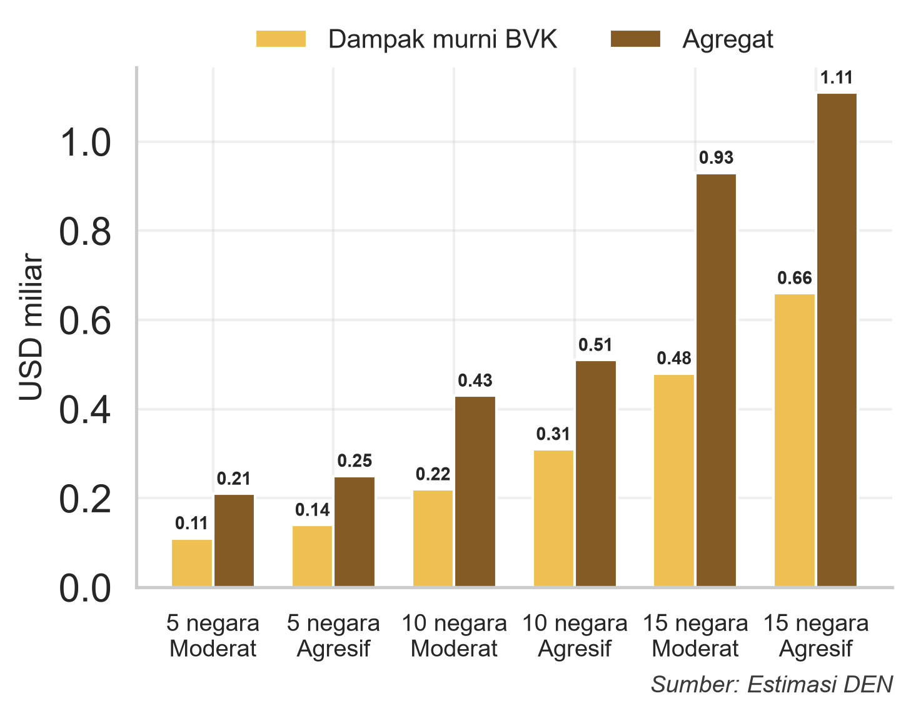{#fig-eksporjasa}

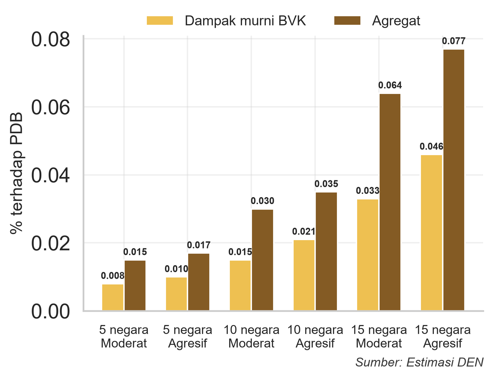{#fig-eksporpdb}
:::

Kebijakan BVK diperkirakan menghasilkan tambahan ekspor jasa perjalanan sebesar USD0,11--0,14 miliar pada Skenario 1 dan meningkat menjadi USD0,48--0,66 miliar pada Skenario 3. Secara keseluruhan, dampak murni kebijakan ini setara dengan 0,008--0,046% PDB. Jika pertumbuhan organik turut diperhitungkan, tambahan ekspor jasa perjalanan secara agregat diperkirakan mencapai hingga USD1,11 miliar, atau setara dengan 0,077% PDB.

Untuk memberikan gambaran mengenai besaran dampak tersebut, defisit transaksi berjalan selama empat triwulan terakhir (triwulan III 2025--triwulan II 2026) tercatat sebesar USD14,4 miliar, atau sekitar 1,0% PDB. Sementara itu, defisit neraca jasa pada periode yang sama mencapai USD19,8 miliar (@fig-neraca). Dengan demikian, tambahan ekspor jasa perjalanan yang berasal dari dampak murni BVK pada Skenario 3 setara dengan 3,3--4,6% dari defisit transaksi berjalan dan 2,4--3,3% dari defisit neraca jasa. Perbandingan ini menunjukkan bahwa perluasan BVK berpotensi membantu memperkecil defisit eksternal, meskipun kontribusinya relatif terbatas.

Perluasan BVK berpotensi memperbaiki neraca transaksi berjalan, meskipun kontribusinya relatif kecil dibandingkan dengan defisit yang ada. Namun, estimasi tambahan ekspor jasa perjalanan masih bersifat bruto dan belum memperhitungkan dua komponen pengurang. Pertama, tambahan impor barang konsumsi dan input layanan pariwisata untuk memenuhi peningkatan permintaan wisman. Kedua, potensi berkurangnya penerimaan valas dari pembayaran visa oleh bukan penduduk, yang merupakan bagian dari estimasi kehilangan PNBP visa sebesar Rp0,41--2,03 triliun. Penilaian dampak neto masih memerlukan estimasi tambahan impor serta verifikasi besaran dan pencatatan penerimaan visa tersebut dalam neraca pembayaran, termasuk memastikan tidak terjadi penghitungan ganda. Aspek-aspek ini belum dikaji lebih lanjut dalam studi.

Hasil studi menunjukkan bahwa perluasan BVK dapat mendukung perbaikan transaksi berjalan melalui peningkatan devisa jasa perjalanan. Namun, kontribusi ini perlu dilengkapi kebijakan untuk mengatasi sumber defisit struktural, terutama defisit pendapatan primer sekitar USD9--10 miliar per triwulan (@fig-neraca), serta defisit jasa transportasi dan asuransi. Kebijakan pendukung mencakup penguatan ekspor barang bernilai tambah, pengembangan jasa transportasi dan asuransi domestik, serta peningkatan reinvestasi laba di dalam negeri. Reinvestasi dapat menahan arus keluar devisa dari repatriasi laba dan memperkuat kapasitas produksi serta ekspor. Walaupun berada di luar lingkup kajian, kebijakan-kebijakan tersebut dapat melengkapi peran BVK dalam memperkuat penerimaan devisa dan ketahanan eksternal.

# Rekomendasi dan Kesimpulan

## Rekomendasi

### Ilustrasi Peta Jalan Implementasi BVK

Sejalan dengan strategi peningkatan kualitas wisatawan, penerapan kebijakan BVK dirancang agar dapat dijalankan secara terukur dan bertahap, sehingga dampak terhadap penerimaan devisa dapat dioptimalkan tanpa mengabaikan aspek kehati-hatian keimigrasian. @fig-petajalan mengilustrasikan tiga fase implementasi, di mana setiap fase (kolom) memuat lima negara baru beserta skor prioritisasinya, disertai ringkasan dampak dan biaya PNBP serta keimigrasian pada baris bawah. Intervensi kebijakan BVK dapat dilaksanakan secara bertahap dalam tiga fase dengan durasi masing-masing 8--12 bulan (melewati dua *peak season*), di mana setiap fase menambahkan lima negara baru berdasarkan skor hasil kerangka prioritisasi yang dijelaskan pada bab sebelumnya.

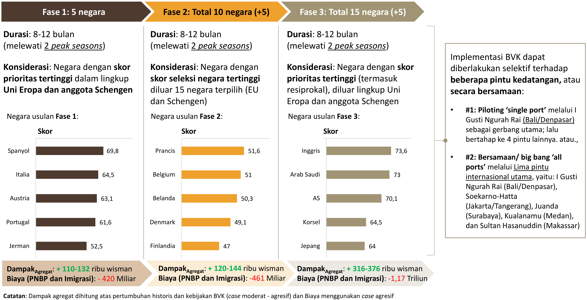{#fig-petajalan width=100%}

Dari sisi jalur kedatangan, implementasi BVK dapat dijalankan secara selektif terhadap beberapa pintu kedatangan, atau secara bersamaan. Opsi pertama adalah *piloting* '*single port*' melalui Bandara I Gusti Ngurah Rai (Bali/Denpasar) sebagai gerbang utama, sebelum diperluas secara bertahap ke empat pintu internasional lainnya. Opsi kedua adalah '*big bang all ports*', yaitu penerapan serentak melalui lima pintu internasional utama: I Gusti Ngurah Rai (Bali/Denpasar), Soekarno-Hatta (Jakarta/Tangerang), Juanda (Surabaya), Kualanamu (Medan), dan Sultan Hasanuddin (Makassar).

### Nilai Tambah terhadap Destinasi Pariwisata Super Prioritas

Selain berdampak langsung terhadap penerimaan devisa secara agregat, pemilihan lima pintu internasional utama tersebut turut memberikan nilai tambah strategis bagi pengembangan lima Destinasi Pariwisata Super Prioritas (DPSP). Kebijakan BVK dapat berfungsi sebagai *indirect targeted enabler* yang meningkatkan *traffic* wisman menuju kelima DPSP, mengingat kedekatan geografis antara masing-masing pintu masuk dengan destinasi tersebut. @fig-dpsp memetakan lima bandara internasional utama beserta DPSP terdekatnya.

Jarak yang dihitung dengan garis lurus, Bandara Kualanamu (Medan) berjarak sekitar 170 km dari Danau Toba; Bandara Juanda (Surabaya) berjarak sekitar 286 km dari Borobudur; dan Bandara I Gusti Ngurah Rai (Bali) berjarak sekitar 124 km dari Mandalika. Sementara, Bandara Sultan Hasanuddin (Makassar) menjadi titik masuk terdekat di antara lima pintu yang dipilih, yaitu ke Labuan Bajo (sekitar 383 km) dan Likupang (sekitar 967 km, dengan transit di Manado). Adapun Bandara Soekarno-Hatta (Jakarta/Tangerang) berperan sebagai gerbang utama nasional dalam skema implementasi BVK.

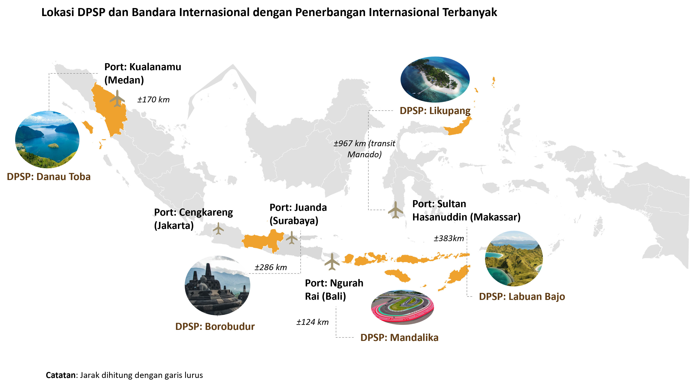{#fig-dpsp width=100%}

Keterkaitan ini menegaskan bahwa manfaat BVK terhadap DPSP bersifat tidak langsung dan sangat bergantung pada ketersediaan konektivitas lanjutan dari pintu masuk internasional menuju destinasi, khususnya untuk rute dengan jarak tempuh yang relatif jauh seperti Makassar--Likupang. Hal ini sejalan dengan strategi jangka panjang pada @tbl-strategi, bahwa perluasan BVK perlu diimbangi dengan penguatan konektivitas, produk dan atraksi wisata, serta infrastruktur pendukung di masing-masing DPSP, agar peningkatan arus wisman melalui BVK dapat benar-benar terkonversi menjadi kunjungan ke destinasi pariwisata prioritas tersebut.

## Kesimpulan

### Kebijakan Visa sebagai Instrumen *Fine-Tuning* Ekonomi

Hasil analisis menunjukkan bahwa kebijakan visa dapat diposisikan tidak hanya sebagai instrumen pengendalian mobilitas dan keimigrasian, tetapi juga sebagai instrumen *fine-tuning* ekonomi dengan mempertimbangkan dinamika kondisi neraca transaksi berjalan. Kemudahan visa tidak harus dipandang secara biner antara bebas visa dan kewajiban visa. Tingkat fasilitas dapat dikalibrasi berdasarkan potensi manfaat ekonomi, resiprositas dan hubungan kerja sama, karakteristik wisman, serta tingkat risiko keimigrasian masing-masing negara.

Pendekatan yang lebih terarah menjadi relevan mengingat karakteristik wisatawan dan negara asalnya sangat beragam. Negara dengan tingkat pendapatan dan *spending/yield per visit* yang tinggi, hubungan ekonomi yang kuat, serta risiko keimigrasian yang relatif rendah dapat dipertimbangkan untuk memperoleh fasilitas yang lebih menguntungkan dan komprehensif melalui fasilitas BVK.

Sementara itu, negara yang memiliki potensi kunjungan besar tetapi belum memenuhi seluruh kriteria dapat difasilitasi melalui *e-Visa on Arrival* (e-VoA) atau *e-Visa* yang lebih sederhana dan terjangkau. Untuk wisatawan dengan tujuan bisnis, investasi, maupun kunjungan berulang, skema *multiple-entry* atau *long-stay visa* dapat menjadi alternatif untuk mengurangi biaya mobilitas tanpa sepenuhnya kehilangan PNBP melalui biaya visa. Adapun untuk kelompok negara yang berada di luar daftar prioritas atau skenario, skema *visa cascading* atau visa atas kepemilikan visa negara ketiga (UE/Amerika) dapat menjadi pilihan.

Dengan demikian, pendekatan ini menempatkan kebijakan visa sebagai instrumen ekonomi yang aktif, yaitu dalam (i) memperkuat ekspor jasa pariwisata dan ketahanan neraca transaksi berjalan, (ii) mendukung pemanfaatan perjanjian dagang seperti IEU-CEPA, (iii) memperbesar mobilitas bisnis dan investasi serta menarik belanja wisman, dan (iv) memberikan *multiplier effect* terhadap perekonomian secara nasional.

### Usulan Rekomendasi dan Arah Kebijakan

Implementasi kebijakan BVK tidak perlu dilakukan secara luas dan serentak, melainkan secara selektif, bertahap, berbasis risiko, dan disertai evaluasi secara berkala. Pada tahap awal, kebijakan dapat diterapkan melalui *piloting* selama 8--12 bulan terhadap sejumlah negara yang memenuhi kriteria, antara lain tingkat pendapatan, *spending* wisatawan, potensi peningkatan kunjungan, hubungan kerja sama bilateral, serta risiko keimigrasian sebagaimana tercermin dalam Skenario 1 hingga Skenario 3.

Efektivitas kebijakan selanjutnya dievaluasi secara berkala berdasarkan sejumlah indikator, antara lain jumlah kunjungan, pengeluaran per kunjungan, lama tinggal, penerimaan devisa, serta perkembangan kasus *overstay* dan pelanggaran keimigrasian. Hasil evaluasi menjadi dasar bagi pemerintah untuk mempertahankan, memperluas, menyesuaikan, atau menghentikan fasilitasi BVK bagi negara tertentu.

Dalam proses tersebut, masukan Kementerian Luar Negeri perlu menjadi salah satu pertimbangan utama, baik pada tahap penetapan negara maupun pada saat evaluasi kebijakan. Hal ini penting karena pemberian dan penyesuaian fasilitas visa tidak hanya memiliki dimensi ekonomi dan keimigrasian, tetapi juga berkaitan dengan hubungan bilateral dan kepentingan diplomatik Indonesia.

Sejak awal, kebijakan perlu dikomunikasikan sebagai fasilitas yang bersifat dinamis dan dievaluasi secara berkala berdasarkan indikator yang objektif. Dengan demikian, apabila di kemudian hari terdapat perubahan cakupan atau tingkat fasilitasi terhadap suatu negara, perubahan tersebut dapat dipahami sebagai bagian dari mekanisme evaluasi kebijakan dan bukan sebagai bentuk penalti atau penurunan kualitas hubungan diplomatik. Pendekatan ini juga memberikan ruang bagi Kementerian Luar Negeri untuk mempertimbangkan aspek resiprositas, perkembangan hubungan bilateral, serta kepentingan strategis Indonesia yang tidak seluruhnya dapat ditangkap melalui indikator kuantitatif.

Kerangka tersebut memungkinkan pemerintah meninjau ulang kebijakan yang telah diterapkan berdasarkan hasil aktual (*evidence-based*). Negara yang memberikan manfaat ekonomi yang kuat tanpa peningkatan risiko yang signifikan dapat dipertimbangkan untuk memperoleh fasilitasi yang lebih luas. Sebaliknya, apabila terdapat peningkatan risiko atau manfaat yang tidak sesuai dengan ekspektasi, tingkat fasilitasi dapat disesuaikan berdasarkan hasil evaluasi dengan tetap mempertimbangkan aspek diplomatik.

Di sisi lain, efektivitas BVK juga perlu didukung dengan peningkatan konektivitas penerbangan internasional. Kemudahan visa akan memberikan dampak yang lebih besar apabila wisatawan memiliki akses penerbangan yang memadai, baik melalui penerbangan langsung maupun peningkatan frekuensi dan kapasitas penerbangan ke Indonesia. Oleh karena itu, pemerintah perlu secara paralel mendorong pembukaan dan penguatan rute penerbangan dari negara-negara prioritas, khususnya negara dengan potensi pasar besar tetapi konektivitas langsung ke Indonesia masih terbatas. Dengan demikian, kebijakan BVK dan peningkatan konektivitas dapat menjadi sebuah paket kebijakan yang saling melengkapi dalam mendorong peningkatan kunjungan, lama tinggal, dan belanja wisatawan.

Dari sisi fiskal, terdapat potensi selisih pada tahun pertama antara tambahan penerimaan pajak pusat dan daerah dengan PNBP visa yang tidak lagi diterima akibat penerapan BVK. Untuk menjaga kapasitas pelaksanaan kebijakan, sebagian dampak fiskal tersebut dapat dipertimbangkan untuk dikompensasi melalui tambahan alokasi anggaran bagi Kementerian Imigrasi dan Pemasyarakatan, terutama untuk memperkuat kapasitas pemantauan, pengawasan, dan penegakan keimigrasian seiring dengan meningkatnya volume kunjungan wisman.

### Keterbatasan dan Arah Pengembangan Studi Lanjutan

Studi ini menyediakan kerangka analisis untuk menyeleksi negara prioritas perluasan BVK serta menilai potensi manfaat dan biayanya. Interpretasi hasil perlu memperhatikan cakupan data dan asumsi yang digunakan. Sejumlah aspek berikut menjadi ruang penyempurnaan untuk studi lanjutan. Pertama, penentuan struktur bobot dalam kerangka seleksi, yang salah satunya menggunakan normalisasi relatif untuk menentukan posisi antarnegara kandidat, masih bersifat preferensial. Struktur bobot tersebut dapat dikembangkan lebih lanjut dengan metodologi yang lebih objektif, misalnya melalui *Principal Component Analysis* (PCA) atau *Analytical Hierarchy Process* (AHP).

Kedua, cakupan evaluasi dibatasi oleh ketersediaan data sekunder *Passenger Exit Survey* (PES) BPS pada 28 negara kandidat dan tidak mencakup negara-negara GCC selain Arab Saudi. Selain itu, data Tindakan Administratif Keimigrasian (TAK) menurut kewarganegaraan belum tersedia untuk publik [@kemenimipas2026tak], sehingga sub-komponen kepatuhan visa diberi skor netral untuk seluruh negara kandidat. Pendekatan ini menghindari pembedaan skor tanpa dukungan data.

Ketiga, estimasi dampak ekonomi mengasumsikan berbagai parameter terkait peningkatan kunjungan (*uplift*) dan efek berganda (*multiplier*) yang seragam berdasarkan estimasi historis @yudhistira2020heterogeneous. Parameter tersebut bersifat statis, sementara dalam realitanya dampak berganda dapat bersifat heterogen dan dinamis tergantung perkembangan ke depan.

Keempat, simulasi belum memperhitungkan potensi dampak ekonomi dari belanja pemerintah yang dapat dibiayai oleh PNBP yang dilepas. Apabila PNBP tersebut diterima dan mengalir ke perekonomian melalui belanja Kementerian/Lembaga, dampak tersebut menjadi biaya peluang dari pelepasan PNBP, sehingga dampak neto kebijakan BVK akan lebih kecil dari estimasi nilai tambah ekonomi dalam kajian ini.

Kelima, simulasi dampak dibatasi pada tahun pertama implementasi, sementara manfaat pariwisata belum terakumulasi dalam jangka panjang. Pelepasan penerimaan PNBP visa dapat dipandang sebagai investasi kebijakan untuk mendorong kunjungan dan belanja wisatawan. Evaluasi jangka menengah diperlukan untuk menilai perkembangan manfaat tersebut dibandingkan dengan kehilangan PNBP visa yang berlanjut selama kebijakan berlaku.

Terakhir, model dalam studi ini belum mempertimbangkan dampak pengalihan wisman ke destinasi pesaing apabila negara lain menerapkan kebijakan serupa. Memperhitungkan faktor persaingan destinasi akan membantu menilai dampak dari perubahan kebijakan dan daya tarik pariwisata di kawasan.

Meskipun demikian, studi ini memberikan dasar analitis bagi penetapan prioritas negara dan penilaian awal konsekuensi ekonomi perluasan BVK. Pengayaan data, kalibrasi parameter, dan evaluasi setelah implementasi dapat memperkuat kerangka yang telah dibangun. Kerja sama antarlembaga, terutama dalam ketersediaan data dan analisis, menjadi penting agar hasil kajian terus mendukung pengambilan keputusan berbasis bukti.

# Acknowledgement {.unnumbered}

Penulis mengucapkan terima kasih kepada Kementerian Imigrasi dan Pemasyarakatan serta Badan Pusat Statistik atas ketersediaan data yang digunakan dalam kajian ini. Penulis juga menyampaikan terima kasih atas diskusi yang konstruktif dengan Deputi Bidang Pemasaran, Kementerian Pariwisata, serta Deputi Bidang Koordinasi Industri, Ketenagakerjaan, dan Pariwisata, Kementerian Koordinator Bidang Perekonomian.

# Reproducibility Statement {.unnumbered}

Seluruh materi untuk mereproduksi kajian ini tersedia pada repositori <https://github.com/den-econ/pariwisata>.

# Referensi {.unnumbered}

::: {#refs}
:::

# Lampiran A. Daftar Negara Populasi 28 Negara {.unnumbered}

| **No.** | **Negara** | **No.** | **Negara** |
|:-------:|:-----------|:-------:|:-----------|
| 1 | Australia | 15 | Denmark |
| 2 | Korea Selatan | 16 | Republik Rakyat China |
| 3 | Amerika Serikat | 17 | India |
| 4 | Jepang | 18 | Swedia |
| 5 | Prancis | 19 | Rusia |
| 6 | Belanda | 20 | Arab Saudi |
| 7 | Inggris | 21 | Austria |
| 8 | Portugal | 22 | Bangladesh |
| 9 | Swiss | 23 | Belgia |
| 10 | Italia | 24 | Finlandia |
| 11 | Jerman | 25 | Mesir |
| 12 | Spanyol | 26 | Norwegia |
| 13 | Selandia Baru | 27 | Pakistan |
| 14 | Kanada | 28 | Srilanka |

: Daftar Negara Populasi 28 Negara Kandidat {#tbl-lampiran tbl-colwidths="[12,38,12,38]"}

`\sumber{`{=latex}BPS [-@bps2025pes], diolah`}`{=latex}
